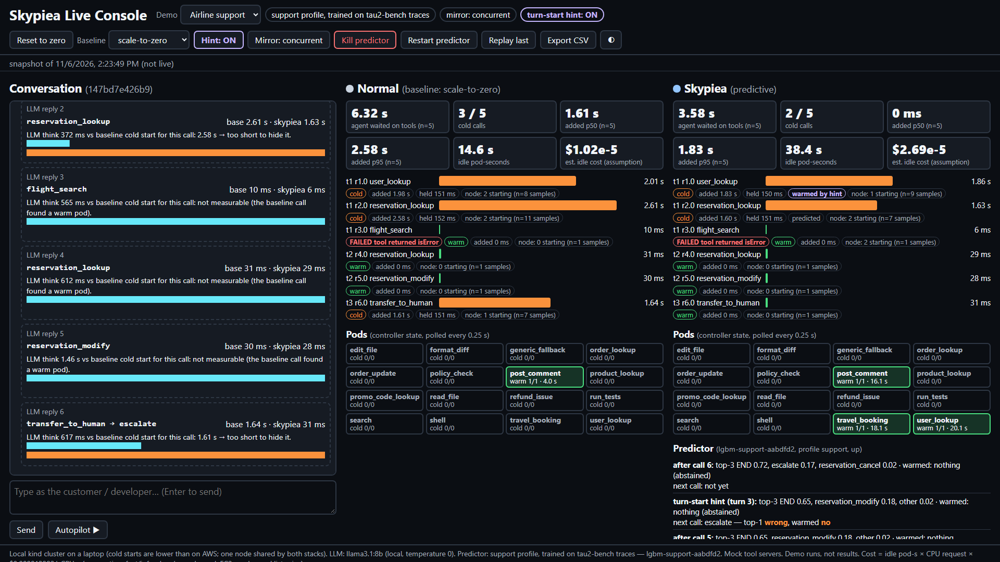
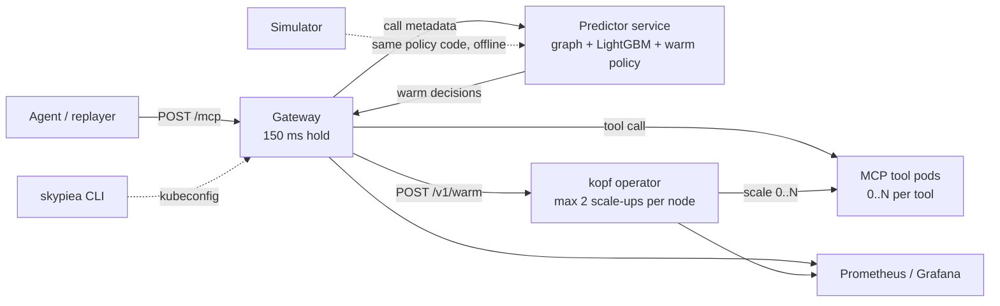

# Skypiea: predictive prewarming for agentic MCP tool calls on Kubernetes

[](https://github.com/SYNKRONOX/skypiea-prewarm/actions/workflows/ci.yml)
[](LICENSE)

AI agents call tools in recognisable patterns: a support agent that looks up an order usually
checks the refund policy next. When each tool runs as a scale-to-zero container, the first call
to a cold tool waits for a pod to start (median 2,572 to 8,366 ms per tool on our AWS node,
[E0 table](#e0-cold-starts-per-tool-kind-vs-aws)). **Skypiea learns those patterns from
tool-call metadata only (tool names, timings, batch structure; never prompts or arguments) and
starts the next tools' pods before the calls arrive, then lets them go back to zero.**

DS252 Cloud Computing course project, Indian Institute of Science (IISc), Bengaluru.
Team: [below](#team). Original plan: [`PRD.md`](PRD.md) (PRD v1.1, unchanged). What we met,
changed or did not do, with evidence: [`docs/PRD_STATUS.md`](docs/PRD_STATUS.md). How the code
fits together: [`dev.md`](dev.md). How to check our results yourself:
[`docs/TESTING.md`](docs/TESTING.md). Index of all documents: [`docs/README.md`](docs/README.md).
Release history: [`CHANGELOG.md`](CHANGELOG.md).

> **Before you quote a number, read [Known limitations](#known-limitations).** Everything on
> kind (laptop) is a functional demo, not a result; the real timings come from one AWS node.

**Contents:** [Install and use](#install-and-use) ·
[Tier 0: tests](#tier-0-tests-only-no-docker) · [Tier 1: local demo](#tier-1-local-demo-on-kind) ·
[Tier 2: Live Console](#tier-2-live-console-baseline-vs-predictive) ·
[Tier 3: AWS](#tier-3-aws-optional-costs-money) · [What Skypiea is](#what-skypiea-is) ·
[Architecture](#architecture) · [What runs where](#what-runs-where) ·
[Training data](#training-data) · [Known limitations](#known-limitations) ·
[Results](#results) · [Troubleshooting](#troubleshooting) · [FAQ](#faq) ·
[Make targets](#make-targets) · [Repository layout](#repository-layout) · [Team](#team)

---

## Install and use

Four tiers. Each one needs everything from the tier before it. Most readers want Tier 0 and
Tier 1; neither needs datasets, an API key, a GPU or a cloud account.

| Tier | What you get | Needs | Time (our laptop) |
|---|---|---|---|
| 0 | Unit tests, lint, size check | Python 3.12, make, git | `make setup` 35 s, `make test` about 2 min ([`docs/TESTING.md`](docs/TESTING.md#measured)) |
| 1 | Whole stack on a local kind cluster; replay under scale-to-zero vs the predictor; scripted agent | + Docker (6 GB memory), kind, kubectl, Helm, 15 GB free disk | `make demo` 270 s on a new cluster with a warm Docker cache ([`docs/DEMO.md`](docs/DEMO.md)); a first build of the images takes longer |
| 2 | Live Console: chat with a local LLM, every tool call sent to a baseline and a predictive stack | + the predictor bundles (`make fetch-models`), Ollama with a tool-calling model | `make live` 2 min 47 s on a new cluster, 44 s when up ([`docs/DEMO.md`](docs/DEMO.md)) |
| 3 | The AWS setup we measured on (one EC2 node, k3s) | + your own AWS account; **costs money** | see Tier 3 |

### Supported platforms

| Platform | Status |
|---|---|
| Windows 11 + WSL2 (Ubuntu 24.04), x86-64, Docker Desktop | **tested** (our laptop: [`docs/DEMO.md`](docs/DEMO.md), Prerequisites) |
| Linux x86-64 (Ubuntu) | **tested** (WSL2 runs an Ubuntu 24.04 x86-64 Linux; every target here ran on it). The CI `e2e` job ([`.github/workflows/ci.yml`](.github/workflows/ci.yml)) runs the same demo on a GitHub `ubuntu-latest` runner on every push to `main` |
| macOS (Intel or Apple silicon), Linux arm64 | **untested.** The scripts use GNU tools (`sha256sum`, `ss`, `setsid`); expect gaps |

### Tier 0: tests only (no Docker)

```bash
git clone https://github.com/SYNKRONOX/skypiea-prewarm.git
cd skypiea-prewarm
make doctor DOCTOR_MODE=test   # checks Python 3.12, make, git; prints the fix for anything missing
make setup                     # .venv from requirements.lock (runtime + dev)
make test                      # pytest on the committed samples in data/samples/ (no download)
make lint check-sizes          # ruff; no tracked file over 50 MB
```

Expected: `make doctor` ends with `doctor: all required checks passed`; `make test` ends with
`N passed, M skipped` and no failures (a few tests skip because they need datasets or local
model bundles that are not committed); `make lint` prints `All checks passed!`;
`make check-sizes` prints `OK: ... tracked files, none over 50 MB.` What each check covers:
[`docs/TESTING.md`](docs/TESTING.md).

No `python3.12`? `make doctor` prints the install command; or `make setup PYTHON=/path/to/python3.12`.

### Tier 1: local demo on kind

Prerequisites (tested versions; other recent ones should work): Docker 29.9.2 with **at least
6 GB of memory**, kind v0.33.0, kubectl v1.37.2, Helm v4.3.1, curl, and about 15 GB of free
disk ([`docs/DEMO.md`](docs/DEMO.md), Prerequisites and Resources).

```bash
make doctor                    # all checks (Docker running and its memory, kind, kubectl, helm, ports)
make demo                      # kind cluster "skypiea" + local registry localhost:5001, 16 tool images,
                               # chart (profile prd), replay PRD Scenario A under scale_to_zero, then
                               # under the predictor; prints a table
make agent-demo                # a tool-calling agent with a SCRIPTED LLM through the gateway (no Ollama)
make demo-failures             # predictor stopped, controller killed: every call must still succeed
bin/skypiea --context kind-skypiea status     # the CLI against the cluster
make demo-clean                # port-forwards off, cluster and registry deleted, .demo/ removed
```

What you should see from `make demo`: eight numbered steps (`=== [12s] 1/8 kind cluster ...` up
to `8/8 summary`), `FAILURES: none` after each replay, and a table like this one (our run on
2026-11-06, recorded in [`docs/TESTING.md`](docs/TESTING.md#measured)):

```
| Scenario | Policy | sessions | calls | ok | cold rate | added p50 ms | added p99 ms | idle pod-s |
|---|---|---|---|---|---|---|---|---|
| A | scale_to_zero | 8 | 19 | 19 | 94.7% | 2,773 | 4,813 | 47 |
| A | predictive | 8 | 19 | 19 | 21.1% | 0 | 2,749 | 106 |
```

Your numbers will differ: these are kind cold starts on one laptop with SYNTHETIC sessions and
shortened gaps. **They are a functional demo, not results.** `make demo` exits non-zero if any
call fails. It leaves the cluster up with loopback-only port-forwards: gateway
http://127.0.0.1:18080/mcp, Grafana http://127.0.0.1:3000 (anonymous viewer). Run it again at
any time; it reuses the cluster and the images. Ports busy? `PF_BASE=28080 GRAFANA_PORT=3300
make demo`. Step-by-step description, failure injection and the full transcript:
[`docs/DEMO.md`](docs/DEMO.md); the agent: [`docs/AGENT.md`](docs/AGENT.md).

The images are kept after `make demo-clean`; `make clean-images` removes them.

### Tier 2: Live Console (baseline vs predictive)



`make live` runs two copies of the platform in one kind cluster: **Normal** (scale-to-zero) and
**Skypiea** (the real `support` predictor trained on tau2-bench, or `coding` trained on
TraceLab). A local web console at http://127.0.0.1:8090 lets you chat with **Skye**, the
assistant of the fictional airline Skypiea Air, run by a local LLM. Every tool call goes to
both stacks, and the screen shows per call whether it was cold or warm and how long Skye waited
on tools on each side. Presenter view and what each panel means: **[`docs/LIVE_DEMO.md`](docs/LIVE_DEMO.md)**.
Design and data sources: [`docs/LIVE_CONSOLE.md`](docs/LIVE_CONSOLE.md). What on the screen is
measured, scripted or mocked: [`docs/MEASURED_VS_SCRIPTED.md`](docs/MEASURED_VS_SCRIPTED.md).
The synthetic airline world: [`docs/SKYPIEA_WORLD.md`](docs/SKYPIEA_WORLD.md). Skye's
correctness suite, before and after the guardrails:
[`docs/SUITE_BEFORE_AFTER.md`](docs/SUITE_BEFORE_AFTER.md).

```bash
make doctor DOCTOR_MODE=live   # also checks ports 8090/3001/18180/18280, bundles and the LLM endpoint
ollama pull llama3.1:8b        # once, where Ollama runs (about 5 GB of memory, docs/DEMO.md)
make fetch-models              # predictor bundles from GitHub Release v1.2 (sha256-verified) -> models/
make live                      # cluster, both stacks, console on :8090, Grafana on :3001
make live-clean                # console off, both stacks uninstalled (cluster and registry stay)
```

- **The bundles.** `make fetch-models` downloads `skypiea-models-af000231.tar.gz` and
  `SHA256SUMS` from release v1.2 of `SYNKRONOX/skypiea-prewarm` (another repository:
  `MODELS_REPO=<owner>/<repo>`), checks both checksums and unpacks into `models/`. Building the
  bundles yourself needs the datasets ([`docs/model.md`](docs/model.md), `make data-all
  model-all`).
- **The LLM.** The console talks to any OpenAI-compatible endpoint: `AGENT_BASE_URL` (default
  `http://localhost:11434/v1`, Ollama) and `AGENT_MODEL` (default `llama3.1:8b`, the only model
  we tested). The model must support tool calling. Ollama also runs without a GPU, only slower
  (not measured by us).
- **No LLM at all?** The console needs one. Without it, use Tier 1: `make agent-demo` sends the
  same kind of tool calls through the gateway with a scripted LLM.
- **What is real:** the tool containers are real pods that cold-start for real (kind timings,
  lower than AWS). The airline data is a mock database inside the console. Skye (llama3.1:8b)
  **can claim actions it did not take**; the console's booking record shows the real state.

### Tier 3: AWS (optional, costs money)

This is how the timings in [Results](#results) were measured. You do not need it to check the
code or the demo. It uses **your own** AWS account and costs **about $0.108 per hour, $2.60 per
day** while the VM runs, and about $0.06 per day for the disk while stopped
([`infra/aws/README.md`](infra/aws/README.md); prices with sources in
[`docs/aws_plan.md`](docs/aws_plan.md)). There is no automatic stop.

Read [`docs/aws_plan.md`](docs/aws_plan.md) first (the resources, security group, IAM,
teardown), then [`infra/aws/README.md`](infra/aws/README.md). One m7i-flex.large in ap-south-1
runs k3s, images in ECR, **no inbound ports** (SSM only). Needs the aws CLI v2 with a profile,
Terraform, `session-manager-plugin`.

```bash
make aws-plan                              # terraform plan -> infra/aws/tfplan; review it
make aws-apply AWS_CONFIRM=yes             # apply exactly that plan (creates billed resources)
make aws-tunnel                            # own terminal: k3s API over SSM
make aws-kubeconfig                        # -> ~/.kube/skypiea-aws (outside the repo)
make build-images push-images-kind push-images-aws AWS_CONFIRM=yes
make deploy-aws PLATFORM=true E0PROBE=false   # gateway, operator, monitoring
make aws-stop                              # pause (disk still billed); make aws-start AWS_CONFIRM=yes
make aws-destroy                           # deletes everything; asks you to type "destroy skypiea"
```

Every `make aws-*` target refuses before any AWS call when the aws CLI or Terraform is
missing, no credentials are configured, or (except `aws-plan`/`aws-apply`) there is no local
Terraform state; targets that create or start resources also need `AWS_CONFIRM=yes`. Terraform
state is local and git-ignored ("Terraform state" in `docs/aws_plan.md`).

---

## What Skypiea is

| Part | What it does | Code |
|---|---|---|
| **Gateway** | One MCP endpoint (`POST /mcp`). Routes each call to a ready pod of its tool, holds a call up to 150 ms if a pod is about to be ready, reports call metadata to the predictor and passes its warm decisions on | [`gateway/`](gateway/) |
| **Operator** | A [kopf](https://kopf.readthedocs.io/) scale-to-zero controller on plain Deployments: scales tools 0..N on warm requests, at most 2 scale-ups at once per node (queued by due time), back to 0 after keep-alive | [`controller/`](controller/) |
| **Predictor** | A Starlette service: Markov/n-gram transition graph + LightGBM re-ranker, and a warm policy that decides which tools to start, when, and how many copies, under an idle budget. One profile per deployment (`support`, `coding`, or the SYNTHETIC `prd` demo) | [`predictors/`](predictors/), [`services/predictor/`](services/predictor/) |
| **CLI** | `skypiea status / policy get / policy set / sessions / trace <sid> / explain <sid>` against kind or AWS | [`bin/skypiea`](bin/skypiea), [`skypiea_cli/`](skypiea_cli/) |

Around them: 16 MCP tool servers with their images ([`tools/`](tools/)), a Helm chart with
Prometheus and Grafana ([`charts/skypiea/`](charts/skypiea/)), a trace pipeline over five public
agent-trace datasets ([`traces/`](traces/)), a discrete-event warm-pool simulator that runs the
same policy code offline ([`sim/`](sim/)), a replayer ([`replayer/`](replayer/),
[`gateway/scenario_run.py`](gateway/scenario_run.py)), a tool-calling agent
([`agent/`](agent/)), the Live Console ([`console/`](console/)) and Terraform for one EC2 k3s
node ([`infra/aws/`](infra/aws/)).

## Architecture



1. The agent (or the replayer) sends each tool call to the gateway.
2. The gateway forwards it to a ready pod of that tool. If none is ready but one will be
   within 150 ms, it holds the call; otherwise the call is cold and waits for a start.
3. After each call the gateway sends the predictor the session's metadata (no arguments).
   The predictor ranks the likely next tools and returns warm decisions (which tool, when,
   how many copies).
4. The gateway forwards them to the operator, which scales Deployments up (respecting the
   per-node scale-up cap) and back to zero when keep-alive expires.

The gateway also has stand-in policies (`scale_to_zero`, `always_warm`, `keep_alive`,
`markov1`) so every baseline runs through the same path. Details: [`dev.md`](dev.md),
[`docs/gateway_controller.md`](docs/gateway_controller.md),
[`docs/predictor_contract.md`](docs/predictor_contract.md), [`docs/model.md`](docs/model.md),
[`docs/infra.md`](docs/infra.md).

## What runs where

| Where | What runs there | Used for |
|---|---|---|
| **Your machine, kind** (Tier 1, 2) | One kind cluster (control plane + worker) and a local registry; the 16 tool Deployments at 0 replicas, gateway, operator, predictor, **Prometheus and Grafana**; the Live Console runs as a local Python process | Functional demos and the Live Console. Every kind number is a demo run (laptop cold starts are a lower bound) |
| **Your machine, Python only** (Tier 0) | Unit and red-team tests; the simulator (`sim/`) and training (`make model-all`) if you have the datasets | Tests; the simulator results in `results/` |
| **AWS** (Tier 3, ours) | One m7i-flex.large in ap-south-1, k3s, images in ECR, results to S3 | The cold-start measurements (E0) and the real scenario runs in `results/`. **Our instance is not running and you do not need it**: the measured files are committed |

## Training data

The predictor bundles are trained on public agent traces; only tool names and timings are used.
The `support` profile serves the Live Console's airline demo; `coding` is the other real
profile; `prd` is a SYNTHETIC demo profile used by `make demo` only.

<!-- training-data:start (generated by tools/training_data_table.py; do not edit) -->
| Profile | Dataset | Role | TRAIN | VAL | TEST | Note |
|---|---|---|---|---|---|---|
| support | tau2_bench | ranker trained on TRAIN; policy tuned on VAL; evaluated on TEST | 99 / 503 | 28 / 171 | 56 / 342 | airline tasks; the users in tau2-bench are LLM-simulated, and tool times come from a simulated run (data/README.md) |
| support | tau_bench | listed in the profile's sources, but without timestamps it cannot be replayed, so the VAL pick used tau2 only (configs/model/profiles.yaml); next-tool accuracy only | 1,073 / 7,785 | 272 / 2,141 | 583 / 4,327 | has no timestamps |
| coding | tracelab | ranker trained on TRAIN; policy tuned on VAL; evaluated on TEST | 4,532 / 435,501 | 358 / 73,230 | 2,092 / 225,290 | real coding-agent traces with per-call timings (data/README.md) |
| coding | copilot_2026 | policy tuned on VAL (with TraceLab); evaluated on TEST | 663 / 29,114 | 158 / 8,299 | 398 / 18,322 | one session per group |
| prd (SYNTHETIC) | synthetic_prd | demo bundle for `make demo`; not used by the Live Console | 2,520 / 7,359 | 630 / 1,820 | 1,350 / 3,892 | generated from the PRD scenario graphs (python -m traces.generate_synthetic) |

Sessions / calls per split; source and input hashes: [`docs/training_data.md`](docs/training_data.md).
<!-- training-data:end -->

Dataset sources and licences: [`data/README.md`](data/README.md). Bundle attribution:
[`docs/MODELS_ATTRIBUTION.md`](docs/MODELS_ATTRIBUTION.md).

## Known limitations

Each of these is a known gap, not something to report as a new bug. The full list, in plain
language, is in [`docs/limits.md`](docs/limits.md).

- **Tier 2 needs the v1.2 release asset.** Tiers 0 and 1 do not need it.
- **The Live Console needs an LLM.** There is no scripted mode for the console; the scripted
  LLM exists for `make agent-demo` (Tier 1).
- **The Live Console's LLM can claim actions it did not take** (llama3.1:8b; a smoke run in
  `docs/handoff/PHASE_A_HANDOFF.md`). The tools refuse invalid changes and the booking record
  shows the real state, but the model's text is not checked beyond simple rules.
- **Only Linux x86-64 and Windows + WSL2 are tested.** macOS and arm64 are untested.
- **`make live` uses fixed local ports** (8090, 3001, 18180-18182, 18280-18283); it refuses to
  start when the console port is taken. `make demo` ports can be moved (`PF_BASE`, `GRAFANA_PORT`).
- **`make demo-clean` and `make clean-cluster` delete the whole kind cluster**, including the
  Live Console's stacks if they run in it.
- **The AWS scenario runs are small**: 20 sessions per policy, so several CIs overlap. Idle
  pod-seconds is one counter per run and has no CI.
- **Cold starts come from one 2-vCPU node.** Pricing is an assumption; there are no
  production cost or latency claims. kind numbers are a lower bound.
- **The simulator gives each session its own pods and its own node.** Real deployments share
  pods across sessions, which would help keep-alive and always-warm more than our simulator
  shows. The 2-at-once start time is borrowed from the 3-at-once measurement.
- **The shipped coding profile was adopted after its TEST margins were seen.** The frozen
  profile's rows are kept next to it.
- **tau2 is small** (56 TEST sessions with timing), and the support profile rests on it alone;
  its users are LLM-simulated. tau-bench has no timestamps, so it gives accuracy numbers only.
- **The `prd` profile and every SYNTHETIC row are synthetic.**
- **Everything on kind (demo, live agent, Live Console, lead-time grid) is a demo run**, on one
  laptop with a local 8B model, with 1 to 10 conversations per cell. In the console, Skypiea
  always idled more than the baseline.
- **CI does not cache Docker layers**: the `e2e` job builds every image from scratch.
- **Nobody independent has reviewed these results.**

Where every quoted number comes from: [`docs/numbers_and_sources.md`](docs/numbers_and_sources.md).

---

## Results

Every number below is copied from a committed file. The source path is given above each
table. [`docs/results_summary.md`](docs/results_summary.md) is generated from the committed
result files only (`make results-summary INFRA_RESULTS=results SCENARIOS='results/scenario_aws*_calls.csv'`),
and lists the commit that last changed each input. Read [Known limitations](#known-limitations) before quoting any
of them.

### Summary

- **Real AWS runs (20 sessions per policy):** predictive has far fewer cold calls than
  scale-to-zero (non-overlapping CIs in both scenarios) and far fewer idle pod-seconds than
  always-warm. Against fixed keep-alive it is **on the keep-alive curve, not above it**: in
  Scenario A it matches keep-alive 10 s; in Scenario B it sits next to keep-alive 60 s. The
  cold-rate CIs overlap in both.
- **Simulator (hundreds of TEST sessions):** at equal idle pod-seconds, the shipped profiles
  warm 3.4 to 18.2 points more calls than keep-alive on AWS cold starts with the scale-up cap.
- **Oracle:** with cached images, a policy that knows every future call warms more calls
  than the shipped profiles at a small fraction of their idle pod-seconds. That gap is the
  remaining headroom for better prediction.
- **Demo runs on kind** (live agent, Live Console, lead-time grid) show the mechanism live with a
  local 8B model. Skypiea waited less on tools and idled more in every console run. They are
  [demo runs](#demo-runs-on-kind-not-results), not results.
- **SYNTHETIC PRD runs** show the mechanism running on the PRD's own scenario graphs. They are
  not evidence about real workloads.

### E0: cold starts per tool, kind vs AWS

Source: [`results/e0_aws_summary.csv`](results/e0_aws_summary.csv), [`results/e0_aws_p3_summary.csv`](results/e0_aws_p3_summary.csv),
[`results/e0_kind_summary.csv`](results/e0_kind_summary.csv), via [`docs/results_summary.md`](docs/results_summary.md) ("E0 cold starts").
Total = scale request (0 to 1 replica) until the first successful MCP call; n = 10 per cell; milliseconds.
AWS: one m7i-flex.large (2 vCPU) running k3s, images from ECR in the same region. kind: a laptop
with a local registry, so it is a **lower bound**. "3 at once" = three tools scaled up at the
same moment.

| Tool | Tier | AWS cached: median (p95) | AWS uncached: median (p95) | AWS cached, 3 at once: median | kind cached: median | kind uncached: median |
|---|---|---|---|---|---|---|
| edit_file | light | 2717 (2794) | 4452 (5121) | 5321 | 2417 | 3870 |
| format_diff | light | 2674 (2797) | 5112 (5387) | 5366 | 1960 | 3736 |
| generic_fallback | heavy | 3768 (3827) | 8210 (8468) | 6143 | 3748 | 5785 |
| order_lookup | medium | 2743 (2908) | 6310 (6510) | 5593 | 2750 | 4648 |
| order_update | light | 2736 (2786) | 5206 (5479) | 5406 | 2287 | 3551 |
| policy_check | heavy | 3651 (3774) | 8258 (8487) | 6198 | 3638 | 5724 |
| post_comment | light | 2574 (2787) | 4474 (5443) | 5429 | 2226 | 3727 |
| product_lookup | medium | 2738 (2913) | 6305 (6582) | 5391 | 2594 | 4644 |
| promo_code_lookup | light | 2734 (2766) | 5089 (5425) | 5224 | 2080 | 3612 |
| read_file | light | 2730 (2740) | 4301 (5289) | 5837 | 2185 | 3510 |
| refund_issue | light | 2572 (2835) | 4610 (5339) | 5415 | 2367 | 3674 |
| run_tests | heavy | 3791 (3962) | 8366 (8627) | 5894 | 3948 | 6321 |
| search | medium | 2701 (2854) | 6134 (6475) | 5820 | 3011 | 4592 |
| shell | light | 2723 (2836) | 5188 (5383) | 5535 | 2114 | 3332 |
| travel_booking | medium | 2750 (2956) | 6291 (6473) | 5434 | 2819 | 4662 |
| user_lookup | light | 2637 (2742) | 4359 (5382) | 5417 | 2242 | 3610 |

Figures: [`results/e0_aws.png`](results/e0_aws.png), [`results/e0_aws_p3.png`](results/e0_aws_p3.png),
[`results/e0_kind.png`](results/e0_kind.png). Raw runs: `results/e0_*_runs.csv`.

### Real AWS scenario runs (gateway + operator + predictor on the cluster)

Source: [`results/scenario_aws_summary.csv`](results/scenario_aws_summary.csv) and
[`results/scenario_aws_calls.csv`](results/scenario_aws_calls.csv), via
[`docs/results_summary.md`](docs/results_summary.md) ("AWS scenario runs"); run notes in
[`docs/handoff/MORNING_REPORT.md`](docs/handoff/MORNING_REPORT.md).

- **Scenario A** (customer support): 20 tau2-bench TEST sessions, 116 calls, `support` profile.
- **Scenario B** (coding agent): 20 TraceLab TEST sessions, 319 calls, `coding` profile.
- Real think gaps and service times. Cold % has a 95% session-level bootstrap CI (1,000
  resamples, seed 0). Idle pod-s is the operator's `skypiea_pod_seconds_idle_total` for the
  whole run; pods are shared by all sessions, so it has no session CI. Added latency is what
  the gateway added to each call.
- The runs come from two nights on two platform images: b652e6b (overnight) and 38c62ec
  (morning: keep-alive 10 s / 60 s and a Markov-1 rerun). The overnight Markov-1 rows are
  marked † (see the footnote under the table). The rerun with a floored stub changed little.

| Scenario | Policy | calls | cold % [95% CI] | idle pod-s | added p50 ms | added p99 ms | platform |
|---|---|---|---|---|---|---|---|
| A | always-warm | 116 | 0.0 [0.0, 0.0] | 6,534 | 0 | 0 | b652e6b |
| A | keep-alive 30 s | 116 | 8.6 [3.8, 14.5] | 888 | 0 | 3638 | b652e6b |
| A | keep-alive 10 s | 116 | 15.5 [9.7, 23.2] | 578 | 0 | 3866 | 38c62ec |
| A | keep-alive 60 s | 116 | 7.8 [2.9, 13.4] | 999 | 0 | 3714 | 38c62ec |
| A | Markov-1 top-1 (floored-stub rerun) | 116 | 16.4 [11.0, 23.1] | 588 | 0 | 4801 | 38c62ec |
| A | Markov-1 top-1 † | 116 | 15.5 [10.6, 21.4] | 624 | 0 | 4121 | b652e6b |
| A | **predictive (Skypiea)** | 116 | 15.5 [10.2, 21.8] | 633 | 0 | 3648 | b652e6b |
| A | scale-to-zero | 116 | 49.1 [40.6, 58.8] | 350 | 67 | 6007 | b652e6b |
| B | always-warm | 319 | 0.9 [0.0, 3.4] | 14,675 | 0 | 2 | b652e6b |
| B | keep-alive 30 s | 319 | 10.3 [6.1, 16.7] | 2,216 | 0 | 5516 | b652e6b |
| B | keep-alive 10 s | 319 | 23.5 [17.1, 31.3] | 1,549 | 0 | 4981 | 38c62ec |
| B | keep-alive 60 s | 319 | 6.6 [3.1, 11.8] | 2,744 | 0 | 4888 | 38c62ec |
| B | Markov-1 top-1 † | 319 | 29.2 [23.7, 35.1] | 1,552 | 0 | 4356 | b652e6b |
| B | Markov-1 top-1 (floored-stub rerun) | 319 | 28.8 [21.9, 35.9] | 1,538 | 0 | 4988 | 38c62ec |
| B | **predictive (Skypiea)** | 319 | 5.6 [2.3, 10.6] | 2,807 | 0 | 5572 | b652e6b |
| B | scale-to-zero | 319 | 58.9 [44.2, 74.1] | 986 | 2426 | 6080 | b652e6b |

† Rounding-handicapped run: the old Markov-1 stub rounded its ranked probabilities and answers that summed to more than 1 were rejected. The `note` column of `results/scenario_aws_summary.csv` says: "rounding-handicapped (stub rounded ranked p; sum > 1 answers rejected)". The floored-stub rerun (platform 38c62ec) is the unmarked Markov-1 row of the same scenario.

What the table shows:

- **vs scale-to-zero:** cold 15.5% [10.2, 21.8] vs 49.1% [40.6, 58.8] in A, and 5.6% [2.3, 10.6]
  vs 58.9% [44.2, 74.1] in B. The CIs do not overlap.
- **vs always-warm:** always-warm is (almost) never cold, but idles 6,534 pod-s in A and 14,675
  in B, against 633 and 2,807 for predictive.
- **vs keep-alive:** predictive lands on the keep-alive cost-latency curve. In A it matches
  keep-alive 10 s (15.5% cold at 633 vs 578 idle pod-s); in B it sits next to keep-alive 60 s
  (5.6% vs 6.6% cold at 2,807 vs 2,744 idle pod-s), with a worse p99 (5,572 vs 4,888 ms). The
  cold-rate CIs overlap, so 20 sessions cannot separate them.
- **vs Markov-1 top-1:** about the same as predictive in A, clearly worse in B.

### Simulator: equal-idle margins over keep-alive (TEST)

Source: [`results/sim_sensitivity.csv.gz`](results/sim_sensitivity.csv.gz), via
[`docs/results_summary.md`](docs/results_summary.md) ("Warm policies: frozen vs retuned vs keep-alive").
Cells: warm % of calls / idle pod-s per 1,000 calls. The number in brackets is the
**equal-idle margin**: warm-percentage points above keep-alive at the same idle pod-seconds
(log-linear between keep-alive 5 s and 600 s). The primary column is the last one: AWS cold
starts, at most 2 scale-ups at once per node, and a start that overlaps another takes the
measured 3-at-once time. TraceLab and Copilot use the `coding` profile; tau2 uses `support`.

| Source | Images | Policy | kind | AWS, no cap | AWS, cap 2 + parallel_3 |
|---|---|---|---|---|---|
| tracelab | cached | keep-alive 30 s | 58.5 / 18,090 | 58.4 / 18,084 | 56.9 / 17,622 |
| tracelab | cached | coding, frozen (before) | 75.3 / 54,932 (+1.2) | 76.0 / 57,219 (+1.5) | 70.8 / 53,587 (-1.9) |
| tracelab | cached | coding, retuned (shipped) | 70.0 / 27,589 (+4.6) | 70.5 / 28,398 (+4.7) | 67.6 / 27,387 (+3.5) |
| tracelab | uncached | keep-alive 30 s | 57.8 / 18,207 | 56.6 / 18,472 | 53.4 / 17,768 |
| tracelab | uncached | coding, frozen (before) | 77.6 / 64,247 (+2.2) | 77.8 / 68,772 (+2.4) | 69.4 / 61,936 (-2.4) |
| tracelab | uncached | coding, retuned (shipped) | 71.8 / 32,099 (+5.1) | 71.7 / 34,243 (+5.3) | 66.5 / 32,361 (+3.4) |
| copilot_2026 | cached | keep-alive 30 s | 51.4 / 19,476 | 51.1 / 19,511 | 49.6 / 19,301 |
| copilot_2026 | cached | coding, frozen (before) | 69.4 / 46,411 (+5.2) | 69.6 / 47,311 (+5.4) | 64.8 / 45,556 (+2.4) |
| copilot_2026 | cached | coding, retuned (shipped) | 67.4 / 34,642 (+6.6) | 67.6 / 35,303 (+6.8) | 64.2 / 34,541 (+5.1) |
| copilot_2026 | uncached | keep-alive 30 s | 49.2 / 19,991 | 47.4 / 20,479 | 44.7 / 20,109 |
| copilot_2026 | uncached | coding, frozen (before) | 68.8 / 50,723 (+5.7) | 67.4 / 53,100 (+5.7) | 60.6 / 49,984 (+1.9) |
| copilot_2026 | uncached | coding, retuned (shipped) | 66.9 / 38,448 (+7.1) | 65.5 / 40,755 (+7.1) | 60.7 / 39,202 (+5.0) |
| tau2_bench | cached | keep-alive 30 s | 56.1 / 18,299 | 56.4 / 18,232 | 56.4 / 18,218 |
| tau2_bench | cached | support | 64.0 / 12,106 (+18.5) | 64.0 / 12,120 (+18.1) | 61.4 / 11,859 (+15.7) |
| tau2_bench | uncached | keep-alive 30 s | 55.6 / 18,319 | 52.6 / 18,973 | 50.3 / 19,413 |
| tau2_bench | uncached | support | 62.3 / 11,920 (+16.1) | 60.2 / 12,041 (+17.7) | 58.8 / 11,990 (+18.2) |

The shipped coding profile ("retuned") was selected on VAL only, but adopted after these TEST
margins had been seen; the frozen profile it replaced is kept in the table. Under the cap, the
frozen profile was below keep-alive on TraceLab.

Sensitivity to the scale-up cap (same source; margin vs keep-alive, cached / uncached; report
only, nothing was tuned on it):

| Source | Policy | cap 1 | cap 2 | cap 3 | no cap |
|---|---|---|---|---|---|
| tracelab | coding, frozen (before) | -1.3 / -3.0 | -1.9 / -2.4 | -0.9 / -0.9 | +0.7 / +1.5 |
| tracelab | coding, retuned (shipped) | +3.6 / +2.8 | +3.5 / +3.4 | +4.0 / +4.2 | +4.3 / +4.9 |
| copilot_2026 | coding, frozen (before) | +2.6 / +0.6 | +2.4 / +1.9 | +3.4 / +3.5 | +3.9 / +4.5 |
| copilot_2026 | coding, retuned (shipped) | +5.2 / +3.8 | +5.1 / +5.0 | +5.5 / +5.8 | +5.6 / +6.1 |
| tau2_bench | support | +16.0 / +15.6 | +15.7 / +18.2 | +15.7 / +18.4 | +15.7 / +18.4 |

Pareto plot of warm rate against idle pod-seconds: [`results/sim_pareto.png`](results/sim_pareto.png)
(kind: [`results/sim_pareto_kind.png`](results/sim_pareto_kind.png)). Full baseline table with
always-warm, keep-alive 60 s, Markov-1 and the PRD FR-2 columns:
[`docs/results_summary.md`](docs/results_summary.md) ("Baselines and FR-2"). For scale, always-warm
in the same setting is 87.8 / 2,375,346 on TraceLab (cached) and 100.0 / 50,923 on tau2 (cached).

### Oracle: the remaining headroom

Source: [`results/sim_sensitivity.csv.gz`](results/sim_sensitivity.csv.gz), via
[`docs/results_summary.md`](docs/results_summary.md) ("Oracle"). Warm % / idle pod-s per 1,000 calls.
The oracle knows every future call. Under the cap, the plain oracle is not achievable; the
cap-aware oracle is the fair ceiling.

| Source | Images | oracle, AWS no cap (ceiling) | oracle, AWS, cap 2 + parallel_3 (not achievable) | cap-aware oracle, AWS, cap 2 + parallel_3 |
|---|---|---|---|---|
| tracelab | cached | 91.1 / 568 | 54.0 / 551 | 72.5 / 1,269 |
| tracelab | uncached | 67.8 / 569 | 34.0 / 529 | 42.3 / 1,128 |
| copilot_2026 | cached | 79.7 / 4,704 | 59.7 / 4,661 | 66.1 / 4,866 |
| copilot_2026 | uncached | 57.8 / 4,715 | 40.3 / 4,654 | 44.8 / 4,881 |
| tau2_bench | cached | 78.1 / 524 | 72.5 / 532 | 72.5 / 532 |
| tau2_bench | uncached | 53.2 / 503 | 38.9 / 499 | 38.9 / 499 |

With cached images the oracle shows the headroom: on TraceLab (AWS, cap 2) the shipped coding
profile reaches 67.6% warm at 27,387 idle pod-s per 1k calls, and the cap-aware oracle 72.5% at
1,269. On tau2, support reaches 61.4% at 11,859 and the oracle 72.5% at 532. The oracle starts
each pod just in time and never keeps one idle. With uncached images many starts are longer
than the think gap before the call (see "Hideable calls" in `docs/results_summary.md`), so the
oracle warms *fewer* calls than the shipped profiles there. It bounds idle cost, not warm rate.

### Next-tool accuracy (E1, TEST)

Source: [`results/p1_accuracy.csv.gz`](results/p1_accuracy.csv.gz) and [`results/p4_ranker.csv`](results/p4_ranker.csv), via
[`docs/results_summary.md`](docs/results_summary.md) ("E1"). Top-1 at k = 1 with 95% group-bootstrap CIs.
The ranker beats Markov-1 on TraceLab, Copilot and tau-bench, but not on tau2 (56 TEST sessions).

| Source | Markov-1 | Markov-3 | n-gram | Ranker | Ranker top-3 | GKF n-gram | GKF ranker |
|---|---|---|---|---|---|---|---|
| tracelab  | 0.399 [0.36,0.47] | 0.466 [0.44,0.52] | 0.454 [0.42,0.51] | 0.529 [0.48,0.57] | 0.843 | 0.473 ± 0.038 | 0.535 ± 0.052 |
| copilot_2026 coding_common | 0.449 [0.43,0.47] | 0.495 [0.48,0.51] | 0.490 [0.47,0.51] | 0.506 [0.49,0.52] | 0.908 | 0.499 ± 0.009 | 0.516 ± 0.011 |
| tau_bench  | 0.547 [0.51,0.58] | 0.592 [0.56,0.63] | 0.607 [0.57,0.64] | 0.618 [0.58,0.65] | 0.848 | 0.601 ± 0.025 | 0.611 ± 0.033 |
| tau2_bench  | 0.620 [0.49,0.73] | 0.588 [0.49,0.67] | 0.620 [0.49,0.73] | 0.520 [0.44,0.58] | 0.860 | 0.574 ± 0.110 | 0.599 ± 0.100 |
| tracelab->copilot_2026 coding_common | 0.428 [0.41,0.45] | 0.436 [0.42,0.46] | 0.437 [0.42,0.46] | 0.458 [0.44,0.48] | 0.872 | - | - |

### Predictor service latency

Source: [`results/loadtest.csv`](results/loadtest.csv) (open loop, one worker; the service alone on
a laptop, not end-to-end). The PRD target is top-3 within 50 ms. Every run is in
[`docs/results_summary.md`](docs/results_summary.md) ("Service latency").

| Load | Workers | s | Bundle | req/s | p50 ms | p99 ms | errors | service compute p99 ms |
|---|---|---|---|---|---|---|---|---|
| open loop 150 req/s | 1 | 60 | lgbm-coding-69d7b94 | 149.6 | 5.8 | 15.9 | 0 | 5.6 |
| open loop 75 req/s | 1 | 60 | lgbm-coding-69d7b94 | 73.8 | 6.5 | 13.2 | 0 | 5.5 |

### SYNTHETIC: PRD scenario runs

**These rows replay traces sampled from the PRD's own scenario graphs, not real sessions.**
They show that the mechanism runs on the PRD scenarios, and say nothing about real workloads.

AWS runs, 20 SYNTHETIC sessions per policy and scenario. Source:
[`results/scenario_aws_prd_SYNTHETIC_summary.csv`](results/scenario_aws_prd_SYNTHETIC_summary.csv) and
[`results/scenario_aws_prd_SYNTHETIC_calls.csv`](results/scenario_aws_prd_SYNTHETIC_calls.csv), via
[`docs/results_summary.md`](docs/results_summary.md). Profile `prd` (SYNTHETIC). In SYNTHETIC B,
predictive is colder than keep-alive 30 s.

| Scenario | Policy | calls | cold % [95% CI] | idle pod-s | added p50 ms | added p99 ms | platform |
|---|---|---|---|---|---|---|---|
| A | always-warm | 42 | 0.0 [0.0, 0.0] | 4,013 | 0 | 0 | b652e6b |
| A | keep-alive 30 s | 42 | 19.0 [7.7, 32.6] | 234 | 0 | 4836 | b652e6b |
| A | Markov-1 top-1 † | 42 | 11.9 [2.6, 22.5] | 249 | 0 | 2378 | b652e6b |
| A | **predictive (Skypiea)** | 42 | 11.9 [2.6, 22.5] | 241 | 0 | 2892 | b652e6b |
| A | scale-to-zero | 42 | 19.0 [7.7, 32.6] | 143 | 0 | 4861 | b652e6b |
| B | always-warm | 80 | 0.0 [0.0, 0.0] | 9,116 | 0 | 0 | b652e6b |
| B | keep-alive 30 s | 80 | 21.2 [8.8, 33.8] | 993 | 0 | 5377 | b652e6b |
| B | Markov-1 top-1 † | 80 | 22.5 [16.2, 28.7] | 843 | 0 | 4997 | b652e6b |
| B | **predictive (Skypiea)** | 80 | 26.2 [21.2, 30.0] | 935 | 0 | 4396 | b652e6b |
| B | scale-to-zero | 80 | 45.0 [30.0, 58.8] | 363 | 0 | 5036 | b652e6b |

† Rounding-handicapped run: the old Markov-1 stub rounded its ranked probabilities and answers that summed to more than 1 were rejected. The `note` column of `results/scenario_aws_prd_SYNTHETIC_summary.csv` says: "rounding-handicapped (stub rounded ranked p; sum > 1 answers rejected)". These SYNTHETIC runs were not rerun with the floored stub.

Simulator, held-out SYNTHETIC TEST. Source: [`results/sim_prd.csv.gz`](results/sim_prd.csv.gz), via
[`docs/results_summary.md`](docs/results_summary.md) ("SYNTHETIC prd profile"). Warm % / idle pod-s per 1k calls.

| Images | Policy | warm % / idle per 1k |
|---|---|---|
| cached | keep_alive_30 | 0.0 / 30,471 |
| cached | markov1_top1 | 35.5 / 36,196 |
| cached | prd | 42.9 / 37,001 |
| cached | oracle | 48.5 / 471 |
| uncached | keep_alive_30 | 0.0 / 30,523 |
| uncached | markov1_top1 | 17.5 / 35,118 |
| uncached | prd | 23.7 / 33,143 |
| uncached | oracle | 29.1 / 516 |

### Demo runs on kind (NOT results)

The runs below are on a laptop with kind (cold starts lower than AWS, both stacks on one node)
with a local 8B model. They show the mechanism live. They are small, and they are not results
like the AWS tables above.

#### Live LLM agent through the gateway

Source: [`results/agent_runs/summary.csv`](results/agent_runs/summary.csv) and
[`results/agent_runs/summary_think.csv`](results/agent_runs/summary_think.csv)
(`make agent-live`, then `python -m agent.summarize`; per-call rows in `results/agent_runs/*_steps.csv`).
**Labels:** kind cold starts on a laptop (a lower bound), local 8B model (llama3.1:8b on
Ollama, temperature 0), SYNTHETIC predictor profile `prd` for both scenarios (bundle
lgbm-prd-a7642d0; the coding profile has no `format_diff`), 10 sessions per cell, real (unscaled)
LLM think times. Sessions run one after another, so a pod kept warm by one session can serve
the next one. No CIs: the cells are too small.

| Scenario | Policy | sessions | ok calls | cold % | added p50 ms | added p99 ms | idle pod-s | LLM followed the scenario graph |
|---|---|---|---|---|---|---|---|---|
| A | scale-to-zero | 10 | 33 | 81.8 | 2,522 | 4,158 | 173 | 4/10 |
| A | keep-alive 30 s | 10 | 33 | 9.1 | 0 | 3,250 | 243 | 4/10 |
| A | **predictive (Skypiea)** | 10 | 32 | 6.2 | 0 | 2,663 | 202 | 4/10 |
| B | scale-to-zero | 10 | 37 | 32.4 | 0 | 3,947 | 223 | 9/10 |
| B | keep-alive 30 s | 10 | 34 | 11.8 | 0 | 3,957 | 270 | 8/10 |
| B | **predictive (Skypiea)** | 10 | 34 | 14.7 | 0 | 2,957 | 307 | 8/10 |

- **Think gaps vs cold starts.** The think gap is the time of the LLM request that produced a
  call. Its median is 1,354.5 ms and its p90 is 2,937.5 ms. The AWS cached cold starts of
  these tools take 2,572 to 3,791 ms (`configs/cold_start.yaml`). Over all 203 calls,
  the think gap alone is long enough to hide the tool's cold start for 7.9% of calls
  (cached) and 0.5% (uncached). Here, the later calls of a multi-call reply count
  as a gap of 0. So with a fast local model, a pod started at the previous call is usually
  not ready in time. Starting pods earlier, or keeping them warm, is what hides most cold
  starts in the table above.
- **Did the LLM follow the scenario?** In B, 25 of 30 sessions followed the PRD pipeline. In
  25 of 30 B sessions the model sent several tool calls in one reply, so those calls reached
  the gateway back to back, with no think gap. In A, only 12 of 30 sessions followed the
  graph: 18 of 30 repeated a tool, and 19 of 30 ended without `finish` (the model still
  answered in text after two simulated "continue" replies). Counts are from
  `results/agent_runs/*_sessions.csv` and `*_steps.csv`.

#### Live Console verification runs

Source: [`results/live_console_demo/runs.md`](results/live_console_demo/runs.md) (generated by
`python -m demo.live_runs_table results/live_console_demo`; caveats in
[`results/live_console_demo/README.md`](results/live_console_demo/README.md)). One
conversation per row, llama3.1:8b at temperature 0, baseline scale-to-zero, mirror concurrent,
cached images.

| run | hint | calls | agent waited on tools, baseline / Skypiea ms | cold calls baseline / Skypiea | idle pod-s baseline / Skypiea | calls warmed by the hint |
|---|---|---|---|---|---|---|
| support_hint_off | off | 6 | 7,548 / 5,311 | 3 / 2 (of 5 / 5 ok) | 17.9 / 36.7 | 0 |
| support_hint_on | on | 6 | 6,322 / 3,576 | 3 / 2 (of 5 / 5 ok) | 18.6 / 50.5 | 1 |
| coding_hint_off | off | 5 | 8,096 / 6,461 | 3 / 2 (of 5 / 5 ok) | 21.1 / 92.4 | 0 |
| coding_hint_on | on | 5 | 7,913 / 4,240 | 3 / 2 (of 5 / 5 ok) | 20.1 / 99.2 | 3 |
| support_predictor_killed | on | 3 | 5,002 / 4,239 | 2 / 2 (of 2 / 2 ok) | 8.3 / 11.1 | 0 |

- Skypiea waited less on tools in every run and **idled more in every run**.
- With the predictor killed, every call that succeeded on the baseline also succeeded on
  Skypiea (fail-open; [`docs/handoff/LIVE_CONSOLE_REPORT.md`](docs/handoff/LIVE_CONSOLE_REPORT.md)).
- One conversation per row and large run-to-run variance: do not read differences between
  rows as effects.

#### Lead-time grid: turn-start hint and lookahead

Source: [`results/live_console_leadtime/tables.md`](results/live_console_leadtime/tables.md)
(generated by `python -m demo.leadtime_table results/live_console_leadtime`); write-up in
[`docs/handoff/LEADTIME_REPORT.md`](docs/handoff/LEADTIME_REPORT.md). 36 autopilot
conversations: 2 demos x 3 hint modes x 2 lookaheads x 3, console tool mapping on. The
scripted customer types at an **assumed** 200 characters per minute. Medians per conversation.

| Demo | lookahead | hint | agent waited on tools, baseline / Skypiea ms | cold calls baseline / Skypiea | idle pod-s baseline / Skypiea |
|---|---|---|---|---|---|
| airline | 1 | off | 15,742 / 4,401 | 16 / 6 (of 22) | 29.7 / 121.9 |
| airline | 1 | Enter | 15,357 / 4,495 | 16 / 6 (of 22) | 29.5 / 147.5 |
| airline | 1 | typing | 17,061 / 4,352 | 18 / 6 (of 24) | 38.6 / 201.7 |
| airline | 2 | off | 18,038 / 8,550 | 17 / 12 (of 23) | 38.8 / 132.9 |
| airline | 2 | Enter | 16,943 / 5,518 | 17 / 8 (of 23) | 38.0 / 179.7 |
| airline | 2 | typing | 14,265 / 8,485 | 15 / 11 (of 21) | 29.7 / 209.9 |
| codefix | 1 | off | 13,331 / 9,579 | 16 / 12 (of 24) | 35.2 / 235.0 |
| codefix | 1 | Enter | 13,520 / 10,286 | 15 / 12 (of 24) | 32.2 / 250.9 |
| codefix | 1 | typing | 14,318 / 9,475 | 15 / 12 (of 24) | 35.5 / 332.0 |
| codefix | 2 | off | 17,350 / 7,394 | 17 / 9 (of 24) | 35.5 / 270.8 |
| codefix | 2 | Enter | 13,681 / 8,084 | 16 / 9 (of 24) | 36.5 / 274.9 |
| codefix | 2 | typing | 13,330 / 7,347 | 15 / 9 (of 24) | 32.7 / 355.5 |

- **What helped** was the normal prediction after each call: the first call of turn 2 was warm
  on Skypiea in every cell (airline reservation_lookup 33-36 ms vs 2,962-3,183 ms on the
  baseline; codefix run_tests 40-43 ms vs 3,137-4,155 ms).
- **The typing hint did not help.** The scripted first message takes about 39-43 s to type,
  longer than the 30 s TTL plus the 5 s purge, so the hinted pod was gone by Enter: the first
  call was warm 0/3 in every cell. It only added idle pod-seconds.
- **The Enter hint did not help** either: the LLM thinks for well under a second, a start takes
  about 1.6-2.9 s.
- **Lookahead 2** helped codefix (9 vs 12 cold calls) and hurt airline (the handover went from
  warm 3/3 to cold 0/3, 1/3 in the typing cell). It was not adopted: in the simulator it brought no gain over lookahead 1
  ([`results/sim_lookahead_val.md`](results/sim_lookahead_val.md),
  [`results/sim_lookahead_test.md`](results/sim_lookahead_test.md)).
- **Skypiea cost more idle pod-seconds in all 12 cells** (4-11x the baseline).

---

## Troubleshooting

Start with `make doctor`: it checks everything below and prints the fix for each failure.
More cases, with the exact error messages: [`docs/DEMO.md`](docs/DEMO.md) (Troubleshooting) and
[`docs/TESTING.md`](docs/TESTING.md).

| Symptom | Cause and fix |
|---|---|
| `make setup: python3.12 not found` | Install Python 3.12 (`make doctor` prints the command for Ubuntu), or `make setup PYTHON=/path/to/python3.12` |
| `make demo stopped before changing anything: fix the FAIL lines above` | `make doctor` found a missing tool, Docker not running, too little Docker memory or disk. Each FAIL line has a `-> fix:` line |
| `Docker is installed but the daemon is not reachable` | Start Docker Desktop (WSL2: Settings > Resources > WSL integration on for your distro) or `sudo systemctl start docker`; add yourself to the `docker` group |
| Tool pods `Pending` or `OOMKilled`, very slow demo | Docker has too little memory: give it at least 6 GB (WSL2: `memory=8GB` under `[wsl2]` in `%UserProfile%\.wslconfig`, then `wsl --shutdown`) |
| `port-forwards did not come up ... a local port is taken by another program` | Something else listens on 18080-18083 or 3000. Free it, or `PF_BASE=28080 GRAFANA_PORT=3300 make demo` (and the same variables for `make agent-demo` / `make demo-failures`) |
| `:5001 is used by another program (needed for the kind registry)` | Another program holds the registry port. Stop it, or use a second registry: `REG_PORT=5002 REG_NAME=kind-registry-2 make demo` |
| `make live: port 8090 is already in use by another program` | Another console (perhaps from another folder) is running. Stop it; `make live` does not move its ports |
| `kubectl ... Unable to connect to the server: EOF` after sleep or a Docker restart | Docker restarted the kind containers. `docker restart skypiea-control-plane skypiea-worker` ([`docs/DEMO.md`](docs/DEMO.md), Troubleshooting), then `make demo-portforward` (or `make live-pf`) |
| Docker stopped in the middle of `make demo` | Start Docker again and re-run `make demo`; every step is idempotent and reuses what exists |
| `make fetch-models`: `The model archive is not available` (exit 2) | There is no network. Nothing was changed |
| `LLM endpoint ... not reachable` / console says the LLM is down | Start Ollama (`ollama serve`) and `ollama pull llama3.1:8b`; on Windows with the cluster in WSL2 see [`docs/DEMO.md`](docs/DEMO.md) ("Ollama on Windows") |
| `make aws-... refused: ...` | By design: AWS targets refuse without the CLIs, credentials, local Terraform state, or (for creating targets) `AWS_CONFIRM=yes`. Nothing was created |

## FAQ

**Do I need a GPU, an API key, datasets or AWS?** No, for Tiers 0 and 1. Tier 2 needs a local
LLM (Ollama runs on CPU, slowly) and the release bundles; Tier 3 needs your own AWS account.

**Are the kind numbers results?** No. They are functional demos on one laptop. The results are
the AWS measurements and the simulator on TEST splits, each with its source file in
[Results](#results).

**Does the predictor see prompts or tool arguments?** No. The gateway sends only the session id,
tool names, timings and batch structure ([`docs/predictor_contract.md`](docs/predictor_contract.md));
`make audit` checks that no session data is kept.

**Can I use another LLM?** Any OpenAI-compatible endpoint with tool calling:
`AGENT_BASE_URL=... AGENT_MODEL=... make live` (or `make agent-demo LLM=openai-compatible`).
We only tested llama3.1:8b on Ollama.

**How do I remove everything?** `make live-clean` (Live Console), `make demo-clean` (cluster,
registry, `.demo/`), `make clean-images` (Docker images), `rm -rf .venv models/lgbm-*` (venv,
downloaded bundles). AWS: `make aws-destroy`.

**Why are some tests skipped?** They need the datasets or the real bundles, which are not
committed. [`docs/TESTING.md`](docs/TESTING.md) lists them.

**Where do I report a problem?** Open an issue with the bug template (environment, steps,
expected, actual); include the output of `make doctor`. Security issues: [`SECURITY.md`](SECURITY.md).

## Make targets

`make help` lists every target with its one-line description ([`Makefile`](Makefile), [`mk/`](mk/)).

| Command | What it does | Clean-up |
|---|---|---|
| `make doctor [DOCTOR_MODE=test\|demo\|live]` | Check the machine; print the fix for each problem | (changes nothing) |
| `make setup` / `make lock` | `.venv` from `requirements.lock` / re-resolve the lock | `rm -rf .venv` |
| `make test` / `make lint` / `make check-sizes` | pytest, ruff, no tracked file over 50 MB | |
| `make secret-sweep [HISTORY=1]` | Credentials and AWS account ids in the tree (and history) | |
| `make demo` / `make agent-demo` / `make demo-failures` | Whole stack on kind, scripted agent, failure injection ([`docs/DEMO.md`](docs/DEMO.md), [`docs/AGENT.md`](docs/AGENT.md)) | `make demo-clean` |
| `make demo-portforward` | Restart the demo port-forwards | `make demo-clean` |
| `make fetch-models` | Download and verify the real predictor bundles into `models/` | `rm -rf models/lgbm-*` |
| `make live` / `make live-pf` | Live Console and its two stacks; restart port-forwards ([`docs/LIVE_DEMO.md`](docs/LIVE_DEMO.md)) | `make live-clean` |
| `make watch-pods` | Pod events of both Live Console stacks, until Ctrl-C (read-only; [`docs/LIVE_DEMO.md`](docs/LIVE_DEMO.md)) | |
| `make build-images` | 16 tool images, E0 probe, platform image | `make clean-images` |
| `make cluster` / `make deploy` | kind cluster + registry; Helm install with the stub predictor | `make clean-cluster` |
| `make deploy-kind-e0` / `make e0-kind` / `make e0-kind-parallel` | E0 cold starts on kind | `make clean-cluster` |
| `make kind-integration` / `make grafana-kind` | Scenario A/B replay through the gateway; Grafana on :3000 | |
| `make agent-live` | Live-LLM agent runs (writes `results/agent_runs/`) | |
| `make data-all` / `make model-all` / `make predictor-image` | Datasets -> `data/processed/`, tune/simulate/export bundles, predictor image (need the datasets) | |
| `make results-summary INFRA_RESULTS=results SCENARIOS='results/scenario_aws*_calls.csv'` | Rebuild `docs/results_summary.md` from committed results | |
| `make redteam` / `make audit` / `make loadtest` | Predictor red-team suite, no-persistence audit, load test (`audit`/`loadtest` need a bundle in `models/`) | |
| `make aws-*` | AWS lifecycle ([`infra/aws/README.md`](infra/aws/README.md)); guarded, see Tier 3 | `make aws-destroy` |

## Repository layout

| Path | Contents |
|---|---|
| [`gateway/`](gateway/) | MCP gateway, stand-in policies, scenario runner and checks |
| [`controller/`](controller/) | kopf scale-to-zero operator |
| [`predictors/`](predictors/), [`services/predictor/`](services/predictor/) | Graph, baselines, LightGBM ranker, warm policy; the predictor service |
| [`sim/`](sim/) | Discrete-event warm-pool simulator, tuning, results summary |
| [`skypiea_cli/`](skypiea_cli/), [`bin/skypiea`](bin/skypiea) | CLI |
| [`traces/`](traces/), [`data/`](data/) | Trace schema, converters, pipeline; dataset notes (data is not committed) |
| [`replayer/`](replayer/) | Open-loop trace replayer |
| [`agent/`](agent/) | Tool-calling agent (OpenAI-compatible or scripted LLM) that uses the gateway's `POST /mcp` only |
| [`demo/`](demo/) | `make demo` / `make live` scripts: inputs from the committed samples, deploy, port-forwards, failure injection, console driver |
| [`console/`](console/) | Live Console: mirrored conversation engine, poller, web UI (offline, hand-written) |
| [`tools/`](tools/) | 16 MCP tool servers and images; `tools/tool_map.yaml` (class -> server) |
| [`charts/skypiea/`](charts/skypiea/), [`deploy/`](deploy/) | Helm chart; kind cluster and platform image |
| [`infra/aws/`](infra/aws/) | Terraform: EC2 k3s (SSM only), ECR, S3 |
| [`experiments/`](experiments/) | E0 cold-start harness and configs |
| [`configs/`](configs/) | Tool classes, vocabularies, model/policy configs, measured cold starts |
| [`results/`](results/) | Committed result files |
| [`docs/`](docs/) | Design, results, limits, handoff notes |
| [`mk/`](mk/) | Make targets: `infra.mk`, `model.mk`, `demo.mk`, `console.mk` (included from the root Makefile) |

## Team

| Name | SR No. | Focus |
|---|---|---|
| G. Parthav | 25302 | Predictors, simulator |
| L. Mohnish | 25451 | Traces, replayer, data pipeline |
| Ch. Dhanunjaya | 25415 | Controller, shaper, tools, deployment, cloud |

We used AI coding assistants for parts of the code and documentation. The team reviewed,
tested and owns all of it.

## License

Code is released under the [MIT License](LICENSE). Datasets are not redistributed and keep
their own licences (see [`data/README.md`](data/README.md)).
