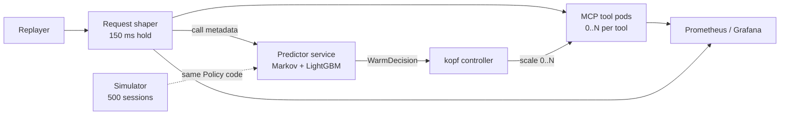

# Skypiea: Predictive Prewarming for Agentic Tool Calls over MCP on Kubernetes

**Skypiea predicts which MCP tools an AI agent will call next and starts their containers on
Kubernetes before the call arrives, cutting cold-start latency at a bounded warm-pool cost.**

> **Status:** work in progress (final evaluation 6 Nov 2026).

[](https://github.com/SYNKRONOX/skypiea-prewarm/actions/workflows/ci.yml)
[](LICENSE)

AI agents call tools in recognisable patterns. A customer-service agent that looks up an
order usually checks the refund policy next. When each tool runs as a scale-to-zero container,
every first call pays a cold start of hundreds of milliseconds to several seconds. Skypiea
learns these patterns from tool-call metadata and warms the right pods just in time, then
scales them back to zero.

---

## Project details

| | |
|---|---|
| **Course** | DS252 Cloud Computing, Indian Institute of Science (IISc), Bengaluru |
| **Project** | Skypiea: Predictive Prewarming for Agentic Tool Calls over MCP on Kubernetes |
| **Final evaluation** | 6 Nov 2026 |

| Name | SR No. | Focus |
|---|---|---|
| G. Parthav | 25302 | Predictors, simulator |
| L. Mohnish | 25451 | Traces, replayer, data pipeline |
| Ch. Dhanunjaya | 25415 | Controller, shaper, tools, deployment, cloud |

We used AI coding assistants for parts of the code and documentation. The team reviewed,
tested and owns all of it.

---

## What Skypiea delivers

- **Metadata-only prediction.** Predictors see only tool names, timings and batch structure,
  never prompts or arguments.
- **One Markov graph, used six ways:**
  1. *Branching:* warm every likely next tool above a threshold, not just the top-1.
  2. *k-step lookahead:* the probability that a tool is needed within the next k steps.
  3. *Semi-Markov timing:* learned inter-call gaps decide *when* to start a pod, not just which one.
  4. *Parallel batch sets with copy counts:* warm a whole parallel batch, with as many copies as it needs.
  5. *Higher-order back-off:* order-n contexts back off to order 1, then to unigram.
  6. *Fleet-wide demand:* sum the per-session predictions into cluster-wide pod targets.
- **A LightGBM re-ranker** over Markov features, with probability calibration and a warm
  threshold derived from the cost of a cold start versus an idle pod. A **small GRU** serves as
  the neural check.
- **Parallel tool calls** are treated as first-class: a batch is a set, not a sequence.
- **Our own scale-to-zero controller.** A [kopf](https://kopf.readthedocs.io/) operator on plain
  Deployments (OpenFaaS CE cannot scale to zero), plus a **request shaper** that holds a call
  for up to **150 ms** when a warm pod is about to be ready.
- **Real workloads:** TraceLab, GitHub Copilot traces, tau-bench, Toolathlon and BFCL.
- **Six baselines and a Pareto plot** of cold-start rate against idle pod-seconds.

---

## Architecture



The replayer sends agent sessions through the shaper, which forwards each call to its tool
pod and tells the predictor what happened. The predictor's policy asks the controller to scale
the likely next tools up before their calls arrive. The simulator runs the same policy code
offline.

---

## Repository layout

| Path | Contents | Owner |
|---|---|---|
| [`traces/`](traces/) | Common trace schema (`Session`, `Batch`, `Call`) and converters | L. Mohnish |
| [`replayer/`](replayer/) | Replays sessions against the cluster, generates load | L. Mohnish |
| [`data/`](data/) | Dataset notes and pipeline (data itself is not committed) | L. Mohnish |
| [`predictors/`](predictors/) | Predictor and policy interfaces, baselines, Markov, evaluation | G. Parthav |
| [`sim/`](sim/) | Discrete-event warm-pool simulator | G. Parthav |
| [`controller/`](controller/) | kopf scale-to-zero controller | Ch. Dhanunjaya |
| [`shaper/`](shaper/) | Request shaper with 150 ms hold | Ch. Dhanunjaya |
| [`tools/`](tools/) | MCP tool container images | Ch. Dhanunjaya |
| [`deploy/`](deploy/) | kind cluster config and Kubernetes manifests | Ch. Dhanunjaya |
| [`infra/`](infra/) | Azure k3s cloud run | Ch. Dhanunjaya |
| [`experiments/`](experiments/) | Experiment runner and YAML configs | All |
| [`results/`](results/), [`report/`](report/) | Experiment outputs and final report | All |
| [`tests/`](tests/) | Unit tests | All |
| [`docs/`](docs/) | Schema and experiment documentation | All |

---

## Experiments

| ID | What we measure |
|---|---|
| **E0** | Real cold starts, with the image cached and uncached |
| **E1** | Next-tool top-1 / top-3 accuracy at k = 1, 3, 5 on tau-bench and Toolathlon |
| **E2** | Whole-batch coverage for parallel calls on BFCL and TraceLab |
| **E3** | Pareto plot of cold-start rate against idle pod-seconds |
| **E4** | p50 / p99 latency CDFs |
| **E5** | 500-session spike and soak test |

**Baselines:**

1. **Scale-to-zero:** no prewarming.
2. **Always-warm:** every tool always has a pod.
3. **Fixed keep-alive:** 30 s to 10 min after last use.
4. **Hybrid histogram:** Shahrad et al., *Serverless in the Wild*, USENIX ATC 2020.
5. **SpecBox-style Markov:** top-1 first-order prewarming.
6. **Oracle:** perfect knowledge of the next calls.

Details are in [`docs/experiments.md`](docs/experiments.md).

---

## Setup guide

### 1. Prerequisites

- [Docker](https://docs.docker.com/get-docker/)
- [kind](https://kind.sigs.k8s.io/docs/user/quick-start/#installation)
- [kubectl](https://kubernetes.io/docs/tasks/tools/)
- Python 3.11 or newer
- `make`

### 2. Clone and install

```bash
git clone https://github.com/SYNKRONOX/skypiea-prewarm.git
cd skypiea-prewarm
python -m venv .venv
source .venv/bin/activate        # Windows: .venv\Scripts\activate
pip install -r requirements.txt
make test
```

### 3. Get the data

Raw data goes in `data/raw/` and is never committed. Rebuild it with the downloader, which
checks sizes first and records sha256 hashes (details in [`data/README.md`](data/README.md)):

```bash
python data/download.py --list
python data/download.py --dataset tracelab
```

Tests do not need the raw data: they use the small samples committed in `data/samples/`.

### 4. Start a local cluster

```bash
make cluster    # kind: 1 control-plane + 2 workers
make deploy     # creates the skypiea-tools namespace and manifests
```

### 5. Run an experiment

```bash
make e1
```

---

## Quick reference

| Command | What it does |
|---|---|
| `make test` | Run unit tests (`pytest -q`) |
| `make lint` | Lint with `ruff check .` |
| `make check-sizes` | Fail if any git-tracked file is over 50 MB |
| `make install-hooks` | Install the pre-commit size check |
| `python data/download.py --dataset <name>` | Download a dataset into `data/raw/` |
| `python tools/inspect_dataset.py <name>` | Read-only overview of a raw dataset |
| `python tools/make_sample.py --all` | Rebuild the committed samples |
| `make cluster` | Create the local kind cluster from `deploy/kind/cluster.yaml` |
| `make deploy` | `kubectl apply -f deploy/k8s/` |
| `make e1` | Run E1 (predictor accuracy) |
| `make clean-cluster` | Delete the kind cluster |
| `kubectl get pods -n skypiea-tools -w` | Watch tool pods scale up and down |

---

## Roadmap

- [x] Project skeleton: schema, policy interface, frequency and Markov predictors, tests, CI
- [ ] Dataset converters (TraceLab, Copilot, tau-bench, Toolathlon, BFCL)
- [ ] E0: cold-start measurements
- [ ] Markov features, LightGBM re-ranker, GRU check
- [ ] Controller, shaper, replayer
- [ ] Baselines and simulator
- [ ] Azure k3s cloud run
- [ ] E1 to E5 and final report

---

## Documentation

- [Trace schema](docs/schema.md)
- [Experiments and baselines](docs/experiments.md)
- [Data](data/README.md)
- [Azure cloud run](infra/azure/README.md)

## License

Code is released under the [MIT License](LICENSE). Datasets are not redistributed and keep
their own licences (see [`data/README.md`](data/README.md)).
