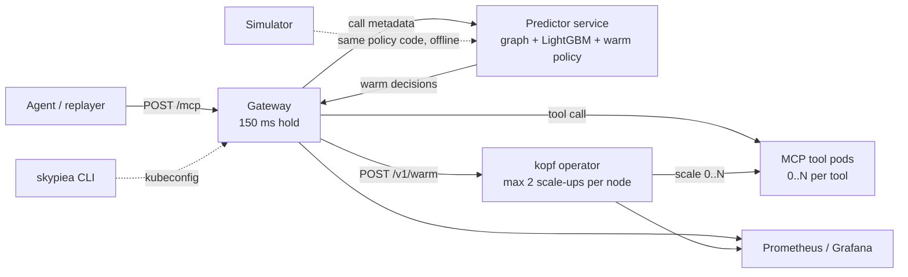

# Skypiea: predictive prewarming for agentic MCP tool calls on Kubernetes

[](https://github.com/SYNKRONOX/skypiea-prewarm/actions/workflows/ci.yml)
[](LICENSE)

AI agents call tools in recognisable patterns: a support agent that looks up an order usually
checks the refund policy next. When each tool runs as a scale-to-zero container, the first call
to a cold tool waits for a pod to start (median 2,572 to 8,366 ms per tool on our AWS node). **Skypiea learns those
patterns from tool-call metadata only (tool names, timings, batch structure; never prompts or
arguments) and starts the next tools' pods before the calls arrive, then lets them go back to
zero.**

It has four parts:

| Part | What it does | Code |
|---|---|---|
| **Gateway** | One MCP endpoint (`POST /mcp`). Routes each call to a ready pod of its tool, holds a call up to 150 ms if a pod is about to be ready, reports call metadata to the predictor and passes its warm decisions on | [`gateway/`](gateway/) |
| **Operator** | A [kopf](https://kopf.readthedocs.io/) scale-to-zero controller on plain Deployments: scales tools 0..N on warm requests, at most 2 scale-ups at once per node (queued by due time), back to 0 after keep-alive | [`controller/`](controller/) |
| **Predictor** | A Starlette service: Markov/n-gram transition graph + LightGBM re-ranker, and a warm policy that decides which tools to start, when, and how many copies, under an idle budget. One profile per deployment (`support`, `coding`, or the SYNTHETIC `prd` demo) | [`predictors/`](predictors/), [`services/predictor/`](services/predictor/) |
| **CLI** | `skypiea status / policy get / policy set / sessions / trace <sid> / explain <sid>` against kind or AWS | [`bin/skypiea`](bin/skypiea), [`skypiea_cli/`](skypiea_cli/) |

Around them: 16 MCP tool servers with their images ([`tools/`](tools/)), a Helm chart with
Prometheus and Grafana ([`charts/skypiea/`](charts/skypiea/)), a trace pipeline over five public
agent-trace datasets ([`traces/`](traces/)), a discrete-event warm-pool simulator that runs the
same policy code offline ([`sim/`](sim/)), a replayer ([`replayer/`](replayer/), [`gateway/scenario_run.py`](gateway/scenario_run.py)),
and Terraform for one EC2 k3s node ([`infra/aws/`](infra/aws/)).

DS252 Cloud Computing course project, Indian Institute of Science (IISc), Bengaluru. Final
evaluation 6 Nov 2026.

| Name | SR No. | Focus |
|---|---|---|
| G. Parthav | 25302 | Predictors, simulator |
| L. Mohnish | 25451 | Traces, replayer, data pipeline |
| Ch. Dhanunjaya | 25415 | Controller, shaper, tools, deployment, cloud |

We used AI coding assistants for parts of the code and documentation. The team reviewed,
tested and owns all of it.

---

## Architecture



1. The agent (or the replayer) sends each tool call to the gateway.
2. The gateway forwards it to a ready pod of that tool. If none is ready but one will be
   within 150 ms, it holds the call; otherwise the call is cold and waits for a start.
3. After each call the gateway sends the predictor the session's metadata (no arguments).
   The predictor ranks the likely next tools and returns warm decisions (which tool, when,
   how many copies).
4. The gateway forwards them to the operator, which scales Deployments up (respecting the
   per-node scale-up cap) and back to zero when keep-alive expires.

The gateway also has stand-in policies (`scale_to_zero`, `always_warm`, `keep_alive`,
`markov1`) so every baseline runs through the same path. Details:
[`docs/gateway_controller.md`](docs/gateway_controller.md),
[`docs/predictor_contract.md`](docs/predictor_contract.md), [`docs/model.md`](docs/model.md),
[`docs/infra.md`](docs/infra.md).

---

## Results

Every number below is copied from a committed file. The source path is given above each
table. [`docs/results_summary.md`](docs/results_summary.md) is generated from the committed
result files only (`make results-summary INFRA_RESULTS=results SCENARIOS='results/scenario_aws*_calls.csv'`),
and lists the commit that last changed each input. Read [Limits](#limits) before quoting any
of them.

### Summary

- **Real AWS runs (20 sessions per policy):** predictive has far fewer cold calls than
  scale-to-zero (non-overlapping CIs in both scenarios) and far fewer idle pod-seconds than
  always-warm. Against fixed keep-alive it is **on the keep-alive curve, not above it**: in
  Scenario A it matches keep-alive 10 s; in Scenario B it sits next to keep-alive 60 s. The
  cold-rate CIs overlap in both.
- **Simulator (hundreds of TEST sessions):** at equal idle pod-seconds, the shipped profiles
  warm 3.4 to 18.2 points more calls than keep-alive on AWS cold starts with the scale-up cap.
- **Oracle:** with cached images, a policy that knows every future call warms more calls
  than the shipped profiles at a small fraction of their idle pod-seconds. That gap is the
  remaining headroom for better prediction.
- **SYNTHETIC PRD runs** show the mechanism running on the PRD's own scenario graphs. They are
  not evidence about real workloads.

### E0: cold starts per tool, kind vs AWS

Source: [`results/e0_aws_summary.csv`](results/e0_aws_summary.csv), [`results/e0_aws_p3_summary.csv`](results/e0_aws_p3_summary.csv),
[`results/e0_kind_summary.csv`](results/e0_kind_summary.csv), via [`docs/results_summary.md`](docs/results_summary.md) ("E0 cold starts").
Total = scale request (0 to 1 replica) until the first successful MCP call; n = 10 per cell; milliseconds.
AWS: one m7i-flex.large (2 vCPU) running k3s, images from ECR in the same region. kind: a laptop
with a local registry, so it is a **lower bound**. "3 at once" = three tools scaled up at the
same moment.

| Tool | Tier | AWS cached: median (p95) | AWS uncached: median (p95) | AWS cached, 3 at once: median | kind cached: median | kind uncached: median |
|---|---|---|---|---|---|---|
| edit_file | light | 2717 (2794) | 4452 (5121) | 5321 | 2417 | 3870 |
| format_diff | light | 2674 (2797) | 5112 (5387) | 5366 | 1960 | 3736 |
| generic_fallback | heavy | 3768 (3827) | 8210 (8468) | 6143 | 3748 | 5785 |
| order_lookup | medium | 2743 (2908) | 6310 (6510) | 5593 | 2750 | 4648 |
| order_update | light | 2736 (2786) | 5206 (5479) | 5406 | 2287 | 3551 |
| policy_check | heavy | 3651 (3774) | 8258 (8487) | 6198 | 3638 | 5724 |
| post_comment | light | 2574 (2787) | 4474 (5443) | 5429 | 2226 | 3727 |
| product_lookup | medium | 2738 (2913) | 6305 (6582) | 5391 | 2594 | 4644 |
| promo_code_lookup | light | 2734 (2766) | 5089 (5425) | 5224 | 2080 | 3612 |
| read_file | light | 2730 (2740) | 4301 (5289) | 5837 | 2185 | 3510 |
| refund_issue | light | 2572 (2835) | 4610 (5339) | 5415 | 2367 | 3674 |
| run_tests | heavy | 3791 (3962) | 8366 (8627) | 5894 | 3948 | 6321 |
| search | medium | 2701 (2854) | 6134 (6475) | 5820 | 3011 | 4592 |
| shell | light | 2723 (2836) | 5188 (5383) | 5535 | 2114 | 3332 |
| travel_booking | medium | 2750 (2956) | 6291 (6473) | 5434 | 2819 | 4662 |
| user_lookup | light | 2637 (2742) | 4359 (5382) | 5417 | 2242 | 3610 |

Figures: [`results/e0_aws.png`](results/e0_aws.png), [`results/e0_aws_p3.png`](results/e0_aws_p3.png),
[`results/e0_kind.png`](results/e0_kind.png). Raw runs: `results/e0_*_runs.csv`.

### Real AWS scenario runs (gateway + operator + predictor on the cluster)

Source: [`results/scenario_aws_summary.csv`](results/scenario_aws_summary.csv) and
[`results/scenario_aws_calls.csv`](results/scenario_aws_calls.csv), via
[`docs/results_summary.md`](docs/results_summary.md) ("AWS scenario runs"); run notes in
[`docs/handoff/MORNING_REPORT.md`](docs/handoff/MORNING_REPORT.md).

- **Scenario A** (customer support): 20 tau2-bench TEST sessions, 116 calls, `support` profile.
- **Scenario B** (coding agent): 20 TraceLab TEST sessions, 319 calls, `coding` profile.
- Real think gaps and service times. Cold % has a 95% session-level bootstrap CI (1,000
  resamples, seed 0). Idle pod-s is the operator's `skypiea_pod_seconds_idle_total` for the
  whole run; pods are shared by all sessions, so it has no session CI. Added latency is what
  the gateway added to each call.
- The runs come from two nights on two platform images: b652e6b (overnight) and 38c62ec
  (morning: keep-alive 10 s / 60 s and a Markov-1 rerun). The overnight Markov-1 rows are
  marked † (see the footnote under the table). The rerun with a floored stub changed little.

| Scenario | Policy | calls | cold % [95% CI] | idle pod-s | added p50 ms | added p99 ms | platform |
|---|---|---|---|---|---|---|---|
| A | always-warm | 116 | 0.0 [0.0, 0.0] | 6,534 | 0 | 0 | b652e6b |
| A | keep-alive 30 s | 116 | 8.6 [3.8, 14.5] | 888 | 0 | 3638 | b652e6b |
| A | keep-alive 10 s | 116 | 15.5 [9.7, 23.2] | 578 | 0 | 3866 | 38c62ec |
| A | keep-alive 60 s | 116 | 7.8 [2.9, 13.4] | 999 | 0 | 3714 | 38c62ec |
| A | Markov-1 top-1 (floored-stub rerun) | 116 | 16.4 [11.0, 23.1] | 588 | 0 | 4801 | 38c62ec |
| A | Markov-1 top-1 † | 116 | 15.5 [10.6, 21.4] | 624 | 0 | 4121 | b652e6b |
| A | **predictive (Skypiea)** | 116 | 15.5 [10.2, 21.8] | 633 | 0 | 3648 | b652e6b |
| A | scale-to-zero | 116 | 49.1 [40.6, 58.8] | 350 | 67 | 6007 | b652e6b |
| B | always-warm | 319 | 0.9 [0.0, 3.4] | 14,675 | 0 | 2 | b652e6b |
| B | keep-alive 30 s | 319 | 10.3 [6.1, 16.7] | 2,216 | 0 | 5516 | b652e6b |
| B | keep-alive 10 s | 319 | 23.5 [17.1, 31.3] | 1,549 | 0 | 4981 | 38c62ec |
| B | keep-alive 60 s | 319 | 6.6 [3.1, 11.8] | 2,744 | 0 | 4888 | 38c62ec |
| B | Markov-1 top-1 † | 319 | 29.2 [23.7, 35.1] | 1,552 | 0 | 4356 | b652e6b |
| B | Markov-1 top-1 (floored-stub rerun) | 319 | 28.8 [21.9, 35.9] | 1,538 | 0 | 4988 | 38c62ec |
| B | **predictive (Skypiea)** | 319 | 5.6 [2.3, 10.6] | 2,807 | 0 | 5572 | b652e6b |
| B | scale-to-zero | 319 | 58.9 [44.2, 74.1] | 986 | 2426 | 6080 | b652e6b |

† Rounding-handicapped run: the old Markov-1 stub rounded its ranked probabilities and answers that summed to more than 1 were rejected. The `note` column of `results/scenario_aws_summary.csv` says: "rounding-handicapped (stub rounded ranked p; sum > 1 answers rejected)". The floored-stub rerun (platform 38c62ec) is the unmarked Markov-1 row of the same scenario.

What the table shows:

- **vs scale-to-zero:** cold 15.5% [10.2, 21.8] vs 49.1% [40.6, 58.8] in A, and 5.6% [2.3, 10.6]
  vs 58.9% [44.2, 74.1] in B. The CIs do not overlap.
- **vs always-warm:** always-warm is (almost) never cold, but idles 6,534 pod-s in A and 14,675
  in B, against 633 and 2,807 for predictive.
- **vs keep-alive:** predictive lands on the keep-alive cost-latency curve. In A it matches
  keep-alive 10 s (15.5% cold at 633 vs 578 idle pod-s); in B it sits next to keep-alive 60 s
  (5.6% vs 6.6% cold at 2,807 vs 2,744 idle pod-s), with a worse p99 (5,572 vs 4,888 ms). The
  cold-rate CIs overlap, so 20 sessions cannot separate them.
- **vs Markov-1 top-1:** about the same as predictive in A, clearly worse in B.

### Simulator: equal-idle margins over keep-alive (TEST)

Source: [`results/sim_sensitivity.csv.gz`](results/sim_sensitivity.csv.gz), via
[`docs/results_summary.md`](docs/results_summary.md) ("Warm policies: frozen vs retuned vs keep-alive").
Cells: warm % of calls / idle pod-s per 1,000 calls. The number in brackets is the
**equal-idle margin**: warm-percentage points above keep-alive at the same idle pod-seconds
(log-linear between keep-alive 5 s and 600 s). The primary column is the last one: AWS cold
starts, at most 2 scale-ups at once per node, and a start that overlaps another takes the
measured 3-at-once time. TraceLab and Copilot use the `coding` profile; tau2 uses `support`.

| Source | Images | Policy | kind | AWS, no cap | AWS, cap 2 + parallel_3 |
|---|---|---|---|---|---|
| tracelab | cached | keep-alive 30 s | 58.5 / 18,090 | 58.4 / 18,084 | 56.9 / 17,622 |
| tracelab | cached | coding, frozen (before) | 75.3 / 54,932 (+1.2) | 76.0 / 57,219 (+1.5) | 70.8 / 53,587 (-1.9) |
| tracelab | cached | coding, retuned (shipped) | 70.0 / 27,589 (+4.6) | 70.5 / 28,398 (+4.7) | 67.6 / 27,387 (+3.5) |
| tracelab | uncached | keep-alive 30 s | 57.8 / 18,207 | 56.6 / 18,472 | 53.4 / 17,768 |
| tracelab | uncached | coding, frozen (before) | 77.6 / 64,247 (+2.2) | 77.8 / 68,772 (+2.4) | 69.4 / 61,936 (-2.4) |
| tracelab | uncached | coding, retuned (shipped) | 71.8 / 32,099 (+5.1) | 71.7 / 34,243 (+5.3) | 66.5 / 32,361 (+3.4) |
| copilot_2026 | cached | keep-alive 30 s | 51.4 / 19,476 | 51.1 / 19,511 | 49.6 / 19,301 |
| copilot_2026 | cached | coding, frozen (before) | 69.4 / 46,411 (+5.2) | 69.6 / 47,311 (+5.4) | 64.8 / 45,556 (+2.4) |
| copilot_2026 | cached | coding, retuned (shipped) | 67.4 / 34,642 (+6.6) | 67.6 / 35,303 (+6.8) | 64.2 / 34,541 (+5.1) |
| copilot_2026 | uncached | keep-alive 30 s | 49.2 / 19,991 | 47.4 / 20,479 | 44.7 / 20,109 |
| copilot_2026 | uncached | coding, frozen (before) | 68.8 / 50,723 (+5.7) | 67.4 / 53,100 (+5.7) | 60.6 / 49,984 (+1.9) |
| copilot_2026 | uncached | coding, retuned (shipped) | 66.9 / 38,448 (+7.1) | 65.5 / 40,755 (+7.1) | 60.7 / 39,202 (+5.0) |
| tau2_bench | cached | keep-alive 30 s | 56.1 / 18,299 | 56.4 / 18,232 | 56.4 / 18,218 |
| tau2_bench | cached | support | 64.0 / 12,106 (+18.5) | 64.0 / 12,120 (+18.1) | 61.4 / 11,859 (+15.7) |
| tau2_bench | uncached | keep-alive 30 s | 55.6 / 18,319 | 52.6 / 18,973 | 50.3 / 19,413 |
| tau2_bench | uncached | support | 62.3 / 11,920 (+16.1) | 60.2 / 12,041 (+17.7) | 58.8 / 11,990 (+18.2) |

The shipped coding profile ("retuned") was selected on VAL only, but adopted after these TEST
margins had been seen; the frozen profile it replaced is kept in the table. Under the cap, the
frozen profile was below keep-alive on TraceLab.

Sensitivity to the scale-up cap (same source; margin vs keep-alive, cached / uncached; report
only, nothing was tuned on it):

| Source | Policy | cap 1 | cap 2 | cap 3 | no cap |
|---|---|---|---|---|---|
| tracelab | coding, frozen (before) | -1.3 / -3.0 | -1.9 / -2.4 | -0.9 / -0.9 | +0.7 / +1.5 |
| tracelab | coding, retuned (shipped) | +3.6 / +2.8 | +3.5 / +3.4 | +4.0 / +4.2 | +4.3 / +4.9 |
| copilot_2026 | coding, frozen (before) | +2.6 / +0.6 | +2.4 / +1.9 | +3.4 / +3.5 | +3.9 / +4.5 |
| copilot_2026 | coding, retuned (shipped) | +5.2 / +3.8 | +5.1 / +5.0 | +5.5 / +5.8 | +5.6 / +6.1 |
| tau2_bench | support | +16.0 / +15.6 | +15.7 / +18.2 | +15.7 / +18.4 | +15.7 / +18.4 |

Pareto plot of warm rate against idle pod-seconds: [`results/sim_pareto.png`](results/sim_pareto.png)
(kind: [`results/sim_pareto_kind.png`](results/sim_pareto_kind.png)). Full baseline table with
always-warm, keep-alive 60 s, Markov-1 and the PRD FR-2 columns:
[`docs/results_summary.md`](docs/results_summary.md) ("Baselines and FR-2"). For scale, always-warm
in the same setting is 87.8 / 2,375,346 on TraceLab (cached) and 100.0 / 50,923 on tau2 (cached).

### Oracle: the remaining headroom

Source: [`results/sim_sensitivity.csv.gz`](results/sim_sensitivity.csv.gz), via
[`docs/results_summary.md`](docs/results_summary.md) ("Oracle"). Warm % / idle pod-s per 1,000 calls.
The oracle knows every future call. Under the cap, the plain oracle is not achievable; the
cap-aware oracle is the fair ceiling.

| Source | Images | oracle, AWS no cap (ceiling) | oracle, AWS, cap 2 + parallel_3 (not achievable) | cap-aware oracle, AWS, cap 2 + parallel_3 |
|---|---|---|---|---|
| tracelab | cached | 91.1 / 568 | 54.0 / 551 | 72.5 / 1,269 |
| tracelab | uncached | 67.8 / 569 | 34.0 / 529 | 42.3 / 1,128 |
| copilot_2026 | cached | 79.7 / 4,704 | 59.7 / 4,661 | 66.1 / 4,866 |
| copilot_2026 | uncached | 57.8 / 4,715 | 40.3 / 4,654 | 44.8 / 4,881 |
| tau2_bench | cached | 78.1 / 524 | 72.5 / 532 | 72.5 / 532 |
| tau2_bench | uncached | 53.2 / 503 | 38.9 / 499 | 38.9 / 499 |

With cached images the oracle shows the headroom: on TraceLab (AWS, cap 2) the shipped coding
profile reaches 67.6% warm at 27,387 idle pod-s per 1k calls, and the cap-aware oracle 72.5% at
1,269. On tau2, support reaches 61.4% at 11,859 and the oracle 72.5% at 532. The oracle starts
each pod just in time and never keeps one idle. With uncached images many starts are longer
than the think gap before the call (see "Hideable calls" in `docs/results_summary.md`), so the
oracle warms *fewer* calls than the shipped profiles there. It bounds idle cost, not warm rate.

### Next-tool accuracy (E1, TEST)

Source: [`results/p1_accuracy.csv.gz`](results/p1_accuracy.csv.gz) and [`results/p4_ranker.csv`](results/p4_ranker.csv), via
[`docs/results_summary.md`](docs/results_summary.md) ("E1"). Top-1 at k = 1 with 95% group-bootstrap CIs.
The ranker beats Markov-1 on TraceLab, Copilot and tau-bench, but not on tau2 (56 TEST sessions).

| Source | Markov-1 | Markov-3 | n-gram | Ranker | Ranker top-3 | GKF n-gram | GKF ranker |
|---|---|---|---|---|---|---|---|
| tracelab  | 0.399 [0.36,0.47] | 0.466 [0.44,0.52] | 0.454 [0.42,0.51] | 0.529 [0.48,0.57] | 0.843 | 0.473 ± 0.038 | 0.535 ± 0.052 |
| copilot_2026 coding_common | 0.449 [0.43,0.47] | 0.495 [0.48,0.51] | 0.490 [0.47,0.51] | 0.506 [0.49,0.52] | 0.908 | 0.499 ± 0.009 | 0.516 ± 0.011 |
| tau_bench  | 0.547 [0.51,0.58] | 0.592 [0.56,0.63] | 0.607 [0.57,0.64] | 0.618 [0.58,0.65] | 0.848 | 0.601 ± 0.025 | 0.611 ± 0.033 |
| tau2_bench  | 0.620 [0.49,0.73] | 0.588 [0.49,0.67] | 0.620 [0.49,0.73] | 0.520 [0.44,0.58] | 0.860 | 0.574 ± 0.110 | 0.599 ± 0.100 |
| tracelab->copilot_2026 coding_common | 0.428 [0.41,0.45] | 0.436 [0.42,0.46] | 0.437 [0.42,0.46] | 0.458 [0.44,0.48] | 0.872 | - | - |

### Predictor service latency

Source: [`results/loadtest.csv`](results/loadtest.csv) (open loop, one worker; the service alone on
a laptop, not end-to-end). The PRD target is top-3 within 50 ms. Every run is in
[`docs/results_summary.md`](docs/results_summary.md) ("Service latency").

| Load | Workers | s | Bundle | req/s | p50 ms | p99 ms | errors | service compute p99 ms |
|---|---|---|---|---|---|---|---|---|
| open loop 150 req/s | 1 | 60 | lgbm-coding-69d7b94 | 149.6 | 5.8 | 15.9 | 0 | 5.6 |
| open loop 75 req/s | 1 | 60 | lgbm-coding-69d7b94 | 73.8 | 6.5 | 13.2 | 0 | 5.5 |

### SYNTHETIC: PRD scenario runs

**These rows replay traces sampled from the PRD's own scenario graphs, not real sessions.**
They show that the mechanism runs on the PRD scenarios, and say nothing about real workloads.

AWS runs, 20 SYNTHETIC sessions per policy and scenario. Source:
[`results/scenario_aws_prd_SYNTHETIC_summary.csv`](results/scenario_aws_prd_SYNTHETIC_summary.csv) and
[`results/scenario_aws_prd_SYNTHETIC_calls.csv`](results/scenario_aws_prd_SYNTHETIC_calls.csv), via
[`docs/results_summary.md`](docs/results_summary.md). Profile `prd` (SYNTHETIC). In SYNTHETIC B,
predictive is colder than keep-alive 30 s.

| Scenario | Policy | calls | cold % [95% CI] | idle pod-s | added p50 ms | added p99 ms | platform |
|---|---|---|---|---|---|---|---|
| A | always-warm | 42 | 0.0 [0.0, 0.0] | 4,013 | 0 | 0 | b652e6b |
| A | keep-alive 30 s | 42 | 19.0 [7.7, 32.6] | 234 | 0 | 4836 | b652e6b |
| A | Markov-1 top-1 † | 42 | 11.9 [2.6, 22.5] | 249 | 0 | 2378 | b652e6b |
| A | **predictive (Skypiea)** | 42 | 11.9 [2.6, 22.5] | 241 | 0 | 2892 | b652e6b |
| A | scale-to-zero | 42 | 19.0 [7.7, 32.6] | 143 | 0 | 4861 | b652e6b |
| B | always-warm | 80 | 0.0 [0.0, 0.0] | 9,116 | 0 | 0 | b652e6b |
| B | keep-alive 30 s | 80 | 21.2 [8.8, 33.8] | 993 | 0 | 5377 | b652e6b |
| B | Markov-1 top-1 † | 80 | 22.5 [16.2, 28.7] | 843 | 0 | 4997 | b652e6b |
| B | **predictive (Skypiea)** | 80 | 26.2 [21.2, 30.0] | 935 | 0 | 4396 | b652e6b |
| B | scale-to-zero | 80 | 45.0 [30.0, 58.8] | 363 | 0 | 5036 | b652e6b |

† Rounding-handicapped run: the old Markov-1 stub rounded its ranked probabilities and answers that summed to more than 1 were rejected. The `note` column of `results/scenario_aws_prd_SYNTHETIC_summary.csv` says: "rounding-handicapped (stub rounded ranked p; sum > 1 answers rejected)". These SYNTHETIC runs were not rerun with the floored stub.

Simulator, held-out SYNTHETIC TEST. Source: [`results/sim_prd.csv.gz`](results/sim_prd.csv.gz), via
[`docs/results_summary.md`](docs/results_summary.md) ("SYNTHETIC prd profile"). Warm % / idle pod-s per 1k calls.

| Images | Policy | warm % / idle per 1k |
|---|---|---|
| cached | keep_alive_30 | 0.0 / 30,471 |
| cached | markov1_top1 | 35.5 / 36,196 |
| cached | prd | 42.9 / 37,001 |
| cached | oracle | 48.5 / 471 |
| uncached | keep_alive_30 | 0.0 / 30,523 |
| uncached | markov1_top1 | 17.5 / 35,118 |
| uncached | prd | 23.7 / 33,143 |
| uncached | oracle | 29.1 / 516 |

---

## Limits

The full list, in plain language, is in **[`docs/limits.md`](docs/limits.md)**. The ones that
matter most when reading the tables above:

- **The AWS scenario runs are small**: 20 sessions per policy, so several CIs overlap. Idle
  pod-seconds is one counter per run and has no CI.
- **Cold starts come from one 2-vCPU node.** Pricing is an assumption; there are no
  production cost or latency claims. kind numbers are a lower bound.
- **The simulator gives each session its own pods and its own node.** Real deployments share
  pods across sessions, which would help keep-alive and always-warm more than our simulator
  shows. The 2-at-once start time is borrowed from the 3-at-once measurement.
- **The shipped coding profile was adopted after its TEST margins were seen.** The frozen
  profile's rows are kept next to it.
- **tau2 is small** (56 TEST sessions with timing), and the support profile rests on it alone.
  tau-bench has no timestamps, so it gives accuracy numbers only.
- **The `prd` profile and every SYNTHETIC row are synthetic.**
- **Nobody independent has reviewed these results.**

Where every quoted number comes from: [`docs/numbers_and_sources.md`](docs/numbers_and_sources.md).

---

## Demo

Two demos run on a laptop with kind. **They are functional demos. Their numbers are not results
like the AWS tables above.**

- **[`docs/DEMO.md`](docs/DEMO.md): `make demo`.** It starts from a fresh clone (after
  `make setup`) with no datasets: it creates the kind cluster, builds the images, deploys the
  chart with profile `prd`, replays SYNTHETIC PRD Scenario A sessions under scale-to-zero and
  then under the predictor, and prints a table (about 4.5 min with a warm Docker cache). It
  leaves the cluster up for the CLI and Grafana. `make demo-failures` stops the predictor and
  kills the controller; the calls still succeed. `make demo-clean` removes everything.
- **[`docs/AGENT.md`](docs/AGENT.md): `make agent-demo`.** A tool-calling agent that talks to
  the tools only through the gateway's `POST /mcp`. Its LLM is either a scripted stand-in (no
  network) or any OpenAI-compatible endpoint (`make agent-demo LLM=openai-compatible`, for
  example local Ollama). The LLM picks the tool order itself.

### Live LLM agent on kind

Source: [`results/agent_runs/summary.csv`](results/agent_runs/summary.csv) and
[`results/agent_runs/summary_think.csv`](results/agent_runs/summary_think.csv)
(`make agent-live`, then `python -m agent.summarize`; per-call rows in `results/agent_runs/*_steps.csv`).
**Labels:** kind cold starts on a laptop (a lower bound), local 8B model (llama3.1:8b on
Ollama, temperature 0), SYNTHETIC predictor profile `prd` for both scenarios (bundle
lgbm-prd-a7642d0; the coding profile has no `format_diff`), 10 sessions per cell, real (unscaled)
LLM think times. Sessions run one after another, so a pod kept warm by one session can serve
the next one. No CIs: the cells are too small.

| Scenario | Policy | sessions | ok calls | cold % | added p50 ms | added p99 ms | idle pod-s | LLM followed the scenario graph |
|---|---|---|---|---|---|---|---|---|
| A | scale-to-zero | 10 | 33 | 81.8 | 2,522 | 4,158 | 173 | 4/10 |
| A | keep-alive 30 s | 10 | 33 | 9.1 | 0 | 3,250 | 243 | 4/10 |
| A | **predictive (Skypiea)** | 10 | 32 | 6.2 | 0 | 2,663 | 202 | 4/10 |
| B | scale-to-zero | 10 | 37 | 32.4 | 0 | 3,947 | 223 | 9/10 |
| B | keep-alive 30 s | 10 | 34 | 11.8 | 0 | 3,957 | 270 | 8/10 |
| B | **predictive (Skypiea)** | 10 | 34 | 14.7 | 0 | 2,957 | 307 | 8/10 |

- **Think gaps vs cold starts.** The think gap is the time of the LLM request that produced a
  call. Its median is 1,354 ms and its p90 is 2,938 ms. The AWS cached cold starts of
  these tools take 2,572 to 3,791 ms (`configs/cold_start.yaml`). Over all 203 calls,
  the think gap alone is long enough to hide the tool's cold start for 7.9% of calls
  (cached) and 0.5% (uncached). Here, the later calls of a multi-call reply count
  as a gap of 0. So with a fast local model, a pod started at the previous call is usually
  not ready in time. Starting pods earlier, or keeping them warm, is what hides most cold
  starts in the table above.
- **Did the LLM follow the scenario?** In B, 25 of 30 sessions followed the PRD pipeline. In
  25 of 30 B sessions the model sent several tool calls in one reply, so those calls reached
  the gateway back to back, with no think gap. In A, only 12 of 30 sessions followed the
  graph: 18 of 30 repeated a tool, and 19 of 30 ended without `finish` (the model still
  answered in text after two simulated "continue" replies). Counts are from
  `results/agent_runs/*_sessions.csv` and `*_steps.csv`.

---

## Quickstart (kind, local)

Needs Docker, [kind](https://kind.sigs.k8s.io/), kubectl, [Helm](https://helm.sh/), `make` and
Python 3.12.

```bash
git clone https://github.com/SYNKRONOX/skypiea-prewarm.git
cd skypiea-prewarm
make setup          # .venv with requirements.lock (runtime + dev)
make test           # unit tests; uses the committed samples in data/samples/, no data download
make lint check-sizes

make build-images   # 16 tool images, E0 probe, platform image (gateway/controller), one at a time
make cluster        # kind: 1 control-plane + 1 worker + local registry localhost:5001
make deploy         # push to localhost:5001; helm install: tools at 0 replicas, gateway,
                    # operator, stub predictor, Prometheus + Grafana
bin/skypiea --context kind-skypiea status
kubectl --context kind-skypiea -n skypiea-tools get pods -w   # watch tools scale 0 <-> 1
make grafana-kind   # Grafana on http://127.0.0.1:3000
make clean-cluster  # delete the cluster and the registry
```

`make deploy` serves the gateway's stand-in policies (`bin/skypiea --context kind-skypiea
policy set keep_alive` etc.). The real predictor needs model bundles, which are not committed
because they are built from the datasets:

```bash
python data/download.py --list                 # then download each dataset (see data/README.md)
make data-all                                  # raw -> data/processed/<source>/
python -m traces.generate_synthetic            # SYNTHETIC PRD traces (timing from real TRAIN data)
make model-all                                 # tune, simulate, export the three bundles, test
make predictor-image                           # skypiea/predictor:<commit>
docker tag skypiea/predictor:<tag> localhost:5001/skypiea/predictor:<tag>
docker push localhost:5001/skypiea/predictor:<tag>
helm upgrade --install skypiea charts/skypiea --kube-context kind-skypiea -n skypiea-tools \
  -f charts/skypiea/values-kind.yaml --set imageTag=$(tools/image_tag.sh) \
  --set platform.enabled=true --set e0Probe.enabled=false \
  --set platform.predictor.serve=model --set platform.predictor.image.tag=<tag> \
  --set platform.predictor.profile=support \
  --set-file platform.predictor.coldStartYaml=configs/cold_start.yaml --wait
make kind-integration   # functional replay of Scenario A and B through the gateway, every policy
```

kind is for functional checks only. All reported timings come from AWS.

## AWS (one EC2 node, k3s)

Read [`docs/aws_plan.md`](docs/aws_plan.md) first (the 50 resources, prices with sources,
security group, IAM, teardown), then follow [`infra/aws/README.md`](infra/aws/README.md). In short:
one m7i-flex.large in ap-south-1 running k3s, images in ECR, **no inbound ports** (SSM only),
about $0.108/h while running, and no automatic stop.

```bash
make aws-plan                    # terraform plan -> infra/aws/tfplan; review it
make aws-apply                   # apply exactly that plan
make aws-tunnel                  # own terminal: k3s API over SSM
make aws-kubeconfig              # -> ~/.kube/skypiea-aws (outside the repo)
make build-images push-images-aws
make deploy-aws PLATFORM=true E0PROBE=false   # gateway, operator, monitoring
make e0-aws-node                 # E0 on the node (see infra/aws/README.md)
make aws-stop                    # pause (disk still billed); make aws-start to resume
make aws-destroy                 # removes everything; asks for confirmation
```

Terraform state is local and git-ignored. See "Terraform state" in `docs/aws_plan.md`.

## Make targets

| Command | What it does |
|---|---|
| `make setup` | Create `.venv` from `requirements.lock` |
| `make lock` | Re-resolve `requirements-dev.txt` against the image pins into `requirements.lock` |
| `make test` / `make lint` / `make check-sizes` | pytest, ruff, no tracked file over 50 MB |
| `make cluster` / `make deploy` / `make clean-cluster` | kind cluster, Helm install, teardown |
| `make deploy-kind-e0` / `make e0-kind` / `make e0-kind-parallel` | E0 cold starts on kind |
| `make kind-integration` | Functional Scenario A/B replay through the gateway |
| `make grafana-kind` | Grafana on http://127.0.0.1:3000 |
| `make demo` / `make demo-failures` / `make demo-clean` | Whole stack on kind from a fresh clone, failure injection, teardown ([`docs/DEMO.md`](docs/DEMO.md)) |
| `make agent-demo [LLM=openai-compatible]` / `make agent-live` | Agent through the gateway; live-LLM runs ([`docs/AGENT.md`](docs/AGENT.md)) |
| `make model-all` | Tune on VAL, simulate on TEST, export bundles (needs `data/processed`) |
| `make predictor-image` | Build the predictor image with the three bundles |
| `make results-summary INFRA_RESULTS=results SCENARIOS='results/scenario_aws*_calls.csv'` | Rebuild `docs/results_summary.md` from committed results |
| `make redteam` / `make audit` / `make loadtest` | Predictor red-team suite, no-persistence audit, load test |
| `make aws-*` | AWS lifecycle, see [`infra/aws/README.md`](infra/aws/README.md) |

## Repository layout

| Path | Contents |
|---|---|
| [`gateway/`](gateway/) | MCP gateway, stand-in policies, scenario runner and checks |
| [`controller/`](controller/) | kopf scale-to-zero operator |
| [`predictors/`](predictors/), [`services/predictor/`](services/predictor/) | Graph, baselines, LightGBM ranker, warm policy; the predictor service |
| [`sim/`](sim/) | Discrete-event warm-pool simulator, tuning, results summary |
| [`skypiea_cli/`](skypiea_cli/), [`bin/skypiea`](bin/skypiea) | CLI |
| [`traces/`](traces/), [`data/`](data/) | Trace schema, converters, pipeline; dataset notes (data is not committed) |
| [`replayer/`](replayer/) | Open-loop trace replayer |
| [`agent/`](agent/) | Tool-calling agent (OpenAI-compatible or scripted LLM) that uses the gateway's `POST /mcp` only |
| [`demo/`](demo/) | `make demo` scripts: inputs from the committed samples, deploy, port-forwards, failure injection |
| [`tools/`](tools/) | 16 MCP tool servers and images; `tools/tool_map.yaml` (class -> server) |
| [`charts/skypiea/`](charts/skypiea/), [`deploy/`](deploy/) | Helm chart; kind cluster and platform image |
| [`infra/aws/`](infra/aws/) | Terraform: EC2 k3s (SSM only), ECR, S3 |
| [`experiments/`](experiments/) | E0 cold-start harness and configs |
| [`configs/`](configs/) | Tool classes, vocabularies, model/policy configs, measured cold starts |
| [`results/`](results/) | Committed result files |
| [`docs/`](docs/) | Design, results, limits, handoff notes |
| [`mk/`](mk/) | Make targets: `infra.mk`, `model.mk`, `demo.mk` (included from the root Makefile) |

## License

Code is released under the [MIT License](LICENSE). Datasets are not redistributed and keep
their own licences (see [`data/README.md`](data/README.md)).
