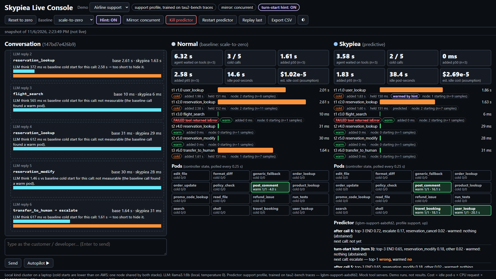

# Demo: the whole stack on a laptop (kind)

`make demo` runs Skypiea end to end on a local kind cluster, starting from a fresh clone. It
creates the cluster, builds the images, deploys the chart with predictor profile `prd`, replays
PRD Scenario A sessions under scale-to-zero and then under the predictor, and prints a table.
The cluster stays up afterwards so you can use the CLI, Grafana and the agent
([`docs/AGENT.md`](AGENT.md)).

> **This is a functional demo. Its numbers are not results.** The think gaps are shortened,
> cold starts come from kind on a laptop, and the sessions are SYNTHETIC (sampled from the PRD
> scenario graphs). For results, see the README and `docs/results_summary.md`.

## Prerequisites

These are the versions we tested with. Other recent versions should work too.

| Tool | Tested version | Notes |
|---|---|---|
| Docker | 29.9.2 (Docker Desktop 4.97.0, WSL2 backend) | give Docker **at least 6 GB of memory** (see Troubleshooting) |
| kind | v0.33.0 (node image v1.37.0) | |
| kubectl | v1.37.2 | |
| Helm | v4.3.1 | |
| Python | 3.12 | `make setup` creates `.venv` from `requirements.lock` |
| make, curl, git | any | |
| OS | Ubuntu 24.04 on WSL2 (kernel 6.18), 24 vCPU, 16 GB RAM laptop | any Linux or macOS with Docker should work |

You do not need datasets, cloud accounts or any API key. `make demo` builds the predictor
bundle from the samples committed in `data/samples/`.

## Commands

```bash
git clone https://github.com/SYNKRONOX/skypiea-prewarm.git && cd skypiea-prewarm
make setup          # .venv from requirements.lock (about 1-2 min with a pip cache)
make demo           # cluster, images, deploy, two replays, table (see "Time" below)
make demo-failures  # optional: stop the predictor, kill the controller; calls must still succeed
make agent-demo     # optional: the agent (scripted LLM) through the gateway, docs/AGENT.md
make demo-clean     # stop port-forwards, delete the cluster and registry, remove .demo/
```

`make demo` can be run again: it reuses the cluster and any images that already exist.

## What each step does, and what you should see

`demo/run.sh` prints `=== [<seconds since start>s] <step>` before each step.

| Step | What it does | Expected output |
|---|---|---|
| 1/8 | `deploy/kind/up.sh`: registry `localhost:5001` + kind cluster `skypiea` (1 control-plane + 1 worker) | `kubectl get nodes` table, both nodes `Ready` |
| 2/8 | `python -m demo.prepare`: SYNTHETIC PRD traces from `data/samples`, a `prd` predictor bundle (`models/lgbm-prd-demo-<sha>/`), and 8 Scenario A + 8 Scenario B sessions with think gaps capped at 6 s and tool time capped at 2 s (`.demo/sessions.json`) | `scenario A: 8 SYNTHETIC sessions, 19 calls ...`, `bundle models/lgbm-prd-demo-<sha>` |
| 3/8 | builds the 16 tool images and the platform image, one at a time, plus `skypiea/predictor:prd-demo-<hash>` (only images that are missing) | one line per image with its size |
| 4/8 | pushes the images to `localhost:5001` | `pushed 16 tools, platform, predictor` |
| 5/8 | `demo/deploy.sh` (helm): 16 tools at 0 replicas, gateway, operator, stub and real predictor (profile `prd`), Prometheus, Grafana. The gateway serves the **stub**. Then the loopback port-forwards start | `deployed: ... gateway serves the stub`, `port-forwards up: ...` |
| 6/8 | `gateway/scenario_run.py`: Scenario A, 8 sessions, 4 at once, policy `scale_to_zero` | one line per session, then `POLICY {...}` and `FAILURES: none` |
| 7/8 | helm switches the gateway to the **real predictor** (`serve=model`), then the same replay under `predictive` | `== A predictive: start ... 'profile': 'prd'`, `FAILURES: none` |
| 8/8 | `python -m demo.table`: the table below | the table |

The table from our run on 2026-11-05 (`.demo/demo_table.md`; functional demo, not results):

```
FUNCTIONAL DEMO, NOT RESULTS: kind cold starts (laptop), SYNTHETIC PRD sessions (profile prd), shortened think gaps

| Scenario | Policy | sessions | calls | ok | cold rate | added p50 ms | added p99 ms | idle pod-s |
|---|---|---|---|---|---|---|---|---|
| A | scale_to_zero | 8 | 19 | 19 | 94.7% | 2,904 | 5,682 | 47 |
| A | predictive | 8 | 19 | 19 | 21.1% | 0 | 3,269 | 105 |
```

You should get the same shape: every call `ok`; under `scale_to_zero` almost every call is
cold, and each one adds a kind cold start (about 2-4 s). Under `predictive` most calls after
the first one in a session find a warm pod, at the cost of more idle pod-seconds. Your exact
numbers will differ from run to run.

When it finishes, the port-forwards are still running, and they listen on 127.0.0.1 only:

```bash
bin/skypiea --context kind-skypiea status     # CLI: tools, replicas, policy
# Grafana:  http://127.0.0.1:3000            (anonymous viewer; "Skypiea" dashboard)
# Gateway:  http://127.0.0.1:18080/mcp       (MCP endpoint used by make agent-demo)
make demo-portforward                         # restart the port-forwards if they died
```

## Time, disk and memory (measured on the laptop above)

| What | Measured |
|---|---|
| `make demo`, cluster already up, images already built | 243 s (4 min 3 s): deploy about 55 s, each replay about 50-65 s, the switch to the model and draining back to 0 about 60 s |
| `make demo` from a fresh clone, **cluster created from scratch** (Docker build cache warm, registry kept) | 270 s (4 min 30 s): cluster 32 s, inputs 2 s, predictor image 10 s, push 16 s, deploy 105 s, scale_to_zero replay 44 s, switch + predictive replay 60 s |
| `make setup` in a fresh clone (pip cache warm) | 35 s |
| `make test` in a fresh clone | 352 passed in 111 s |
| Building the images on a machine with no Docker cache | not measured here (this laptop's build cache was warm). Expect several minutes for each image tier, mostly `pip install` |
| Docker memory, kind nodes | right after the fresh-clone checks: control-plane 0.92 GiB, worker 1.16 GiB, registry 52 MiB; during the live agent runs: 0.7 GiB and 1.1 GiB |
| Image sizes (uncompressed, as `docker images` shows them) | light tools 265 MB (9 of them), medium 470 MB (4), heavy 625-634 MB (3), platform 400 MB, predictor 528 MB, `kindest/node` 1.34 GB, `registry:3` 87 MB. The images share their Python base layers, so the disk they take together is much less than the sum |
| Disk inside the kind worker (containerd image store) | 3.5 GB, including older image tags from earlier work |

Plan for **about 15 GB of free disk** and **6 GB of memory for Docker**.

## Failure injection

```bash
make demo-failures
```

`demo/failure_injection.sh` sends tool calls through the gateway (`python -m agent.probe`)
while one part of the platform is down. It then restores the stack:

1. **Predictor stopped**: `skypiea-model` and `skypiea-predictor` are scaled to 0. The gateway
   gets no decisions, so it falls back to plain scale-to-zero (the cold path). Every call must
   still succeed; the calls are simply cold.
2. **Controller killed**: the controller pod is deleted, and its Deployment starts a new one.
   The new controller rebuilds its state from the Deployment annotations. Calls made in the
   meantime must still succeed.

Our run (fresh clone, 2026-11-05), `PASS: every call succeeded`:

```
== 1. predictor stopped (skypiea-model and skypiea-predictor scaled to 0)
  order_lookup   ok=True cold=True added_ms=2832.2 wall_ms=2867
  policy_check   ok=True cold=True added_ms=3977.5 wall_ms=4009
  refund_issue   ok=True cold=True added_ms=1974.1 wall_ms=2004
== 2. controller killed (pod deleted)
  read_file      ok=True cold=True added_ms=1516.1 wall_ms=1554
  run_tests      ok=True cold=True added_ms=3992.7 wall_ms=4031
  format_diff    ok=True cold=True added_ms=1978.5 wall_ms=2016
  post_comment   ok=True cold=True added_ms=1952.6 wall_ms=2000
   controller back: 1/1 ready
```

## Troubleshooting

- **Docker memory on WSL2.** Docker Desktop limits the memory of its VM. If tool pods stay
  `Pending` or get `OOMKilled`, or Grafana restarts, raise the limit: Docker Desktop >
  Settings > Resources (or `memory=8GB` under `[wsl2]` in `%UserProfile%\.wslconfig`, then
  `wsl --shutdown`). Check it with `docker info --format '{{.MemTotal}}'`.
- **`kubectl` says `Unable to connect to the server: EOF` after the laptop slept or Docker
  Desktop restarted.** Docker Desktop's port forward to the kind API server can go stale. Run
  `docker restart skypiea-control-plane skypiea-worker`; the cluster comes back with its state.
  We hit this on 2026-11-05.
- **`ports are not available: ... /forwards/expose returned unexpected status: 500`** when
  kind creates the cluster: Docker Desktop's port forwarding is broken for every container.
  Restart Docker Desktop. From WSL, use the Windows binary, `<DockerDesktop
  install>/resources/bin/docker.exe desktop restart`. Check that it works with
  `docker run --rm -d -p 127.0.0.1:45999:5000 --name pf registry:3 && docker rm -f pf`.
- **Ports in use.** The demo uses 5001 (registry), 18080-18083 (gateway, controller, stub,
  model) and 3000 (Grafana), all on 127.0.0.1. Find what holds a port with
  `ss -ltnp | grep :18080`. Change the gateway port with `GW_PORT=...`, or start without
  Grafana: `GRAFANA=0 demo/portforward.sh start`.
- **Port-forwards die.** `kubectl port-forward` stops when its pod is replaced (for example
  after a helm upgrade). Run `make demo-portforward`.
- **Pull secrets / `ErrImagePull`.** kind pulls from the local registry `localhost:5001`, so
  no pull secret is needed (`values-kind.yaml` sets `imagePullSecrets: []`). If pods show
  `ErrImagePull`, check that the registry runs (`docker ps | grep kind-registry`) and that
  it is connected to the `kind` network (`deploy/kind/up.sh` does both; you can run it again).
  For a private remote registry, create a `docker-registry` Secret in `skypiea-tools` and set
  `imagePullSecrets`.
- **Grafana evicted in a loop** (older checkouts): Grafana 13 downloaded about 540 MB of
  plugins into a 512 Mi volume. The chart now sets `GF_PLUGINS_PREINSTALL_DISABLED=true`.
  Clean up with `kubectl -n skypiea-tools delete pods -l skypiea.io/tool=skypiea-grafana
  --field-selector=status.phase!=Running`.
- **Ollama on Windows, cluster and agent in WSL2** (for `make agent-demo LLM=openai-compatible`):
  - With WSL **mirrored networking** (`networkingMode=mirrored` in `.wslconfig`), Windows'
    `localhost:11434` is also `localhost:11434` in WSL. Check it with
    `curl http://localhost:11434/v1/models`.
  - With the default **NAT networking**, use the Windows host IP instead:
    `export AGENT_BASE_URL=http://$(ip route show default | awk '{print $3}'):11434/v1`. You
    also need Ollama to listen on all interfaces: set the user environment variable
    `OLLAMA_HOST=0.0.0.0` on Windows, then restart Ollama, and allow port 11434 through the
    Windows firewall.
  - The agent runs in WSL, not inside the cluster, so pods never need to reach Ollama.
- **`helm` prints `client-side throttling` lines.** These are harmless.
- **Start over:** `make demo-clean && make demo`.

## Fresh-clone check (2026-11-05)

On the laptop above: `git clone` into a new directory, then `make setup` (new venv), `make
test` (352 passed), `make lint`, `make check-sizes`, and the cluster deleted
(`KEEP_REGISTRY=1 deploy/kind/down.sh`). Then `make demo` (rc 0, 270 s; table below),
`make agent-demo` (scripted: 6/6 sessions finished in the graph order, every call ok, 3 min
30 s), `make agent-demo LLM=openai-compatible AGENT_N=1` (Ollama llama3.1:8b, ok), and
`make demo-failures` (PASS). Docker images were already in the local build cache, so the image
builds were not timed from scratch.

```
| Scenario | Policy | sessions | calls | ok | cold rate | added p50 ms | added p99 ms | idle pod-s |
|---|---|---|---|---|---|---|---|---|
| A | scale_to_zero | 8 | 19 | 19 | 89.5% | 3,663 | 6,792 | 38 |
| A | predictive | 8 | 19 | 19 | 21.1% | 0 | 2,499 | 106 |
```

The full terminal transcript of this run is a backup for a live presentation:
[`docs/demo_transcript.log`](demo_transcript.log). It is a plain `script` log, because
asciinema is not installed.

The first attempt failed before kind could create the cluster: Docker Desktop answered
`ports are not available ... /forwards/expose returned unexpected status: 500` for **every**
published port, not only kind's. `docker desktop restart` from WSL failed, but the Windows CLI
worked: `"/mnt/c/Users/<you>/AppData/Local/Programs/DockerDesktop/resources/bin/docker.exe"
desktop restart`. After that restart, port publishing worked and the registry kept its images.

---

# Live Console: baseline vs predictive, side by side

Design and data sources: [`docs/LIVE_CONSOLE.md`](LIVE_CONSOLE.md). Verification runs:
[`results/live_console_demo/runs.md`](../results/live_console_demo/runs.md) (demo runs, not
results). Backup for a live talk: [`docs/live_backup/`](live_backup/).



## Start and stop

```bash
make setup                      # once
ollama pull llama3.1:8b         # once, on the machine running Ollama (Windows or Linux)
make live                       # both stacks + console (about 45 s with cached images)
# open http://127.0.0.1:8090 (console) and http://127.0.0.1:3001 (Grafana)
make live-clean                 # console off, both stacks uninstalled (cluster/registry kept)
```

`make live` needs the real predictor image (`skypiea/predictor:af000231bc7b`, support +
coding bundles) in the local registry or in Docker. It is built from the datasets (README
Quickstart), so a clean laptop without the datasets cannot run `make live`; `make demo` can.
Override the image with `PRED_IMAGE_TAG=<tag>` and the LLM with `AGENT_BASE_URL` /
`AGENT_MODEL`. `LIVE_DEMO=coding make live` starts with the coding profile.

Measured on the laptop in "Prerequisites" (2026-11-06):

| What | Measured |
|---|---|
| `make live`, cluster up, images built | 44 s from a fresh clone (two runs: 44.1 s, 43.5 s); 25-32 s when the stacks are already installed |
| first `make live` on a new cluster (stacks + image builds from a warm cache) | 2 min 47 s |
| switching the demo (support <-> coding: helm upgrade of the predictive stack) | about 30-60 s |
| Docker memory, both stacks idle | control plane 0.72 GiB, worker 1.09 GiB, registry 60 MiB |
| Docker memory after the verification runs (a few tool pods warm, Prometheus data) | control plane 0.91 GiB, worker 2.15 GiB, registry 43 MiB |
| console process | 87 MiB RSS |
| kind worker image store | 3.2 GB |
| Ollama (llama3.1:8b, Q4_K_M) | about 5 GB of GPU/host memory on the Ollama machine (not part of Docker) |

## 7-minute presenter script

Before the talk: `make live`, open the console at 125-150% zoom, pick the theme with ◐, and
send one throwaway message to load the model ("hi"). The first LLM call after Ollama has been
idle includes loading the model (seconds). Then press **Reset to zero**.

| Time | Do | Point at and say |
|---|---|---|
| 0:00-0:45 | Nothing yet | Header: "support profile, trained on tau2-bench traces", mirror concurrent, hint off. Two columns: the same agent calls are sent to two copies of the platform. **Normal** scales tools to zero; **Skypiea** predicts the next tool and starts it. Pod grids: all 16 tools cold on both. Footer: local laptop, cold starts here are shorter than on AWS. |
| 0:45-2:15 | Type: *Hi, this is Priya Menon, user id priya_menon_1119. I need to change my flight on reservation R35033531 to an earlier day. What are my options?* (or press **Autopilot ▶**, labelled AUTOPILOT) | user_lookup is cold on **both** stacks: nothing predicts the first call without the hint. Then the Predictor panel: after user_lookup it says reservation_lookup (p about 0.84) and warms travel_booking; the pod grid shows it starting. Then the **think window** under reservation_lookup: the LLM thought for about 0.4-0.7 s, the cold start is about 2-3 s. **The prediction was right, but the think time was too short to hide the start.** Say it plainly. |
| 2:15-3:00 | Point at flight_search | Warm on both stacks: the five airline tools live in one server (travel_booking), so once it is up, every airline call is warm. Prediction works on servers, not tool names. |
| 3:00-4:00 | Click **Hint: off → ON**, **Reset to zero**, send the first message again | Now the agent tells the predictive gateway "a new turn starts" (turn number only, never the text). The predictor answers with the first-tool distribution learned from tau2-bench (user_lookup 0.50) and warms it while the LLM thinks. user_lookup on Skypiea shows "warmed by hint" and waits less (in our runs about 0.9-1.9 s instead of about 2 s). The start is only partly hidden, because the LLM thinks for well under a second. With a human typing, the head start would be longer. |
| 4:00-5:00 | Type: *Please move me to flight SK482 on day 36.* Then *Thanks. That's all.* | If the agent hands over (transfer_to_human), point at the Skypiea column: post_comment was warmed earlier (the support profile expects an escalation after a reservation lookup, p about 0.45), so it is warm while the baseline cold-starts. Point at the totals: "agent waited on tools", cold calls, p95, idle pod-seconds. **Skypiea pays for it with more idle pod-seconds** (higher estimated idle cost, an assumption from pricing.yaml). |
| 5:00-5:45 | Click **Kill predictor**, then send a message (or Autopilot) | The predictor panel turns red (DOWN), and decisions read error:ConnectError. **Every call still succeeds**: the gateway falls back to plain scale-to-zero. Click **Restart predictor**. |
| 5:45-6:30 | Switch **Demo → Code fix** (about 30-60 s; talk meanwhile), then Autopilot | Profile label changes: "coding profile: model trained on TraceLab traces, warm policy tuned on TraceLab + Copilot". Point at a reply with several calls: "batch: prediction cannot help between calls sent in the same reply". Calls marked "written as text" are where the 8B model wrote the call as JSON text instead of a tool call; the console executed it and says so. |
| 6:30-7:00 | Open Grafana (:3001) | The same story over time for both namespaces: cold rate, added latency, warm pool, hint warms, predictor errors (the kill shows up there). Close with: this is one laptop and one small model; the AWS tables in the README are the results. |

What to say honestly when prediction cannot hide a start:

- **Batched calls:** calls the LLM sends in one reply arrive back to back. Nothing can be
  warmed between them.
- **Short think time:** a fast local model thinks for about 0.4-1.5 s; a cold start here
  takes about 2-3 s. A right prediction made at the previous call is then only partly in time.
  The console's think window shows this per call against the baseline's own cold start for the
  same call.
- **The first call** of a conversation is cold without the hint, because there is no history.
- **Run-to-run variance is large** (both stacks on one node; up to 4 pods starting at once).
  One conversation is a demo, not a measurement.

## Live Console troubleshooting

- **`make live` says the predictor image is missing:** see "Start and stop". `make demo`
  works without it.
- **Console shows "baseline stub not reachable" or stale pods:** run `make live-pf`, which
  restarts the loopback port-forwards; they die when a pod they point at is replaced.
- **LLM errors in the status line:** check `curl $AGENT_BASE_URL/models`. For Ollama on
  Windows with WSL, see the Ollama item under Troubleshooting above.
- **First answer takes many seconds:** Ollama is loading the model. Send a warm-up message
  before the talk.
- **Reset takes up to about 40 s:** it waits for the controllers' keep-alive (30 s) plus the
  5 s purge; nothing is forced down on purpose.
- **Ports:** console 8090 (`CONSOLE_PORT`), Grafana 3001, baseline 18180-18182, predictive
  18280-18283; all on 127.0.0.1.
- **Docker Desktop port errors (`/forwards/expose ... 500`) or `kubectl` EOF:** see
  Troubleshooting above (restart Docker Desktop, or the kind node containers).
- **A tool call FAILED on both stacks:** usually the 8B model sent an invalid argument
  (e.g. `day` as a word). The model sees the tool's error and usually retries. It is not a
  platform failure.
- **Playwright:** not installed; adding it needs a new package (not done). Screenshots come
  from a locally installed Chrome with `make live-screenshot NAME=...` (`?snapshot=1` view).
